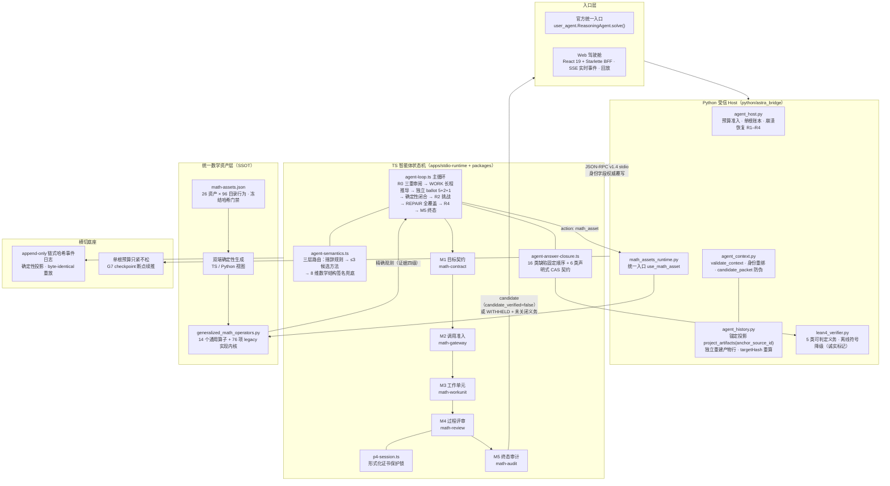

# Zygos 项目架构图

> 与实装源码对齐（HEAD `7d4dfb5`，分支 `fix/closure-source-trust`）。主说明见 [README.md](README.md)，演进历史见 [HANDOFF.md](HANDOFF.md)。

## 全链路架构图



## 主求解链

```
原始题
  → M1 目标契约（compileP2Contract：义务清单 + 任务 DAG，运行期动态扩线）
  → R0 三重审阅（MEANING / METHOD / TASK_TOOL 独立评审 + 确定性聚合，≤1 定向复核）
  → WORK 长程推导（64KB 依赖隔离投影，G2 停滞让渡，预算只紧不松）
  → 独立 ballot（5 盲解 + 2 锚定审计 + 1 证书；规范化键计票 / 逐分量多数；绝不合成答案）
  → 确定性闭合（16 类缺陷固定顺序）+ 6 类声明式 CAS 契约 + Lean 4 可判定义务
  → R2 挑战归并 → REPAIR（反例全覆盖才替换，父候选保留）→ R4 复核
  → M5 projectProtectedFinal 终态裁决
  → candidate（candidate_verified=false）或 WITHHELD + 未关闭义务清单
```

## 层职责与源码映射

| 层 | 职责 | 关键源码 |
| --- | --- | --- |
| 入口层 | 官方接口、Web 观测与回放 | `user_agent.py`、`apps/web-demo`、`python/astra_web` |
| Python Host | 协议可信、身份重绑、预算、恢复、工具执行、锚定投影防伪 | `agent_host.py`、`agent_context.py`、`agent_history.py`、`agent_client.py` |
| TS 状态机 | 目标契约、动态调度、长程推导、投票、闭合、审查修复、终态 | `agent-loop.ts`、`agent-semantics.ts`、`agent-answer-closure.ts`、`p4-session.ts`、M1–M5 包 |
| 统一资产 | 26 资产 × 96 目录行为，双端生成，证据四级分流 | `math-assets.json`、`math_assets_runtime.py`、`generalized_math_operators.py` |
| 形式化核验 | 5 类 Lean 4 义务 + 离线符号降级（明确标记） | `lean4_verifier.py` |
| 横切底座 | 事件溯源、确定性重放、单根预算、断点续推 | `runtime-core`、G7 checkpoint |

## 可信交付三原则

1. **锚定投影**：以 Node 声明的交付 source 为锚，Host 独立重建产物行并逐字段比对；放弃独立加冕 front-runner，保留 candidate_packet + targetHash 全部防伪校验（`0b6497e → 3320212`）。
2. **证据受控**：EXACT_FOR_INPUT / EXHAUSTIVE / SAMPLE / HEURISTIC 四级分流，抽样与启发式永不升级为全称证明；离线无 Lean 内核走符号降级并明确标记。
3. **诚实交付**：`candidate_verified` 恒为 `false`；多选须 `CERT1|OPTIONS` 全覆盖，多问按 `MULTIPART` 覆盖所有 leaf 分问；未解/超时/异常如实标注并计入分母。

## 实测口径（v14，3320212）

- **100 题交付候选 100/100**（真实模型，front+tail 两段合并，**协议失败面清零**；merged 非单次全量盲跑）。
- **语义答对 87/100（87%）**：有对选错 8 题（选择机制空间）、真短板 5 题（11/18/47/64/83）、oracle 95/100（兑现率 91.6%）。
- 历史对照：v8（fcbd311）93 交付 / 73% 语义；82 项资产行为 E2E 全绿（离线门禁）。
