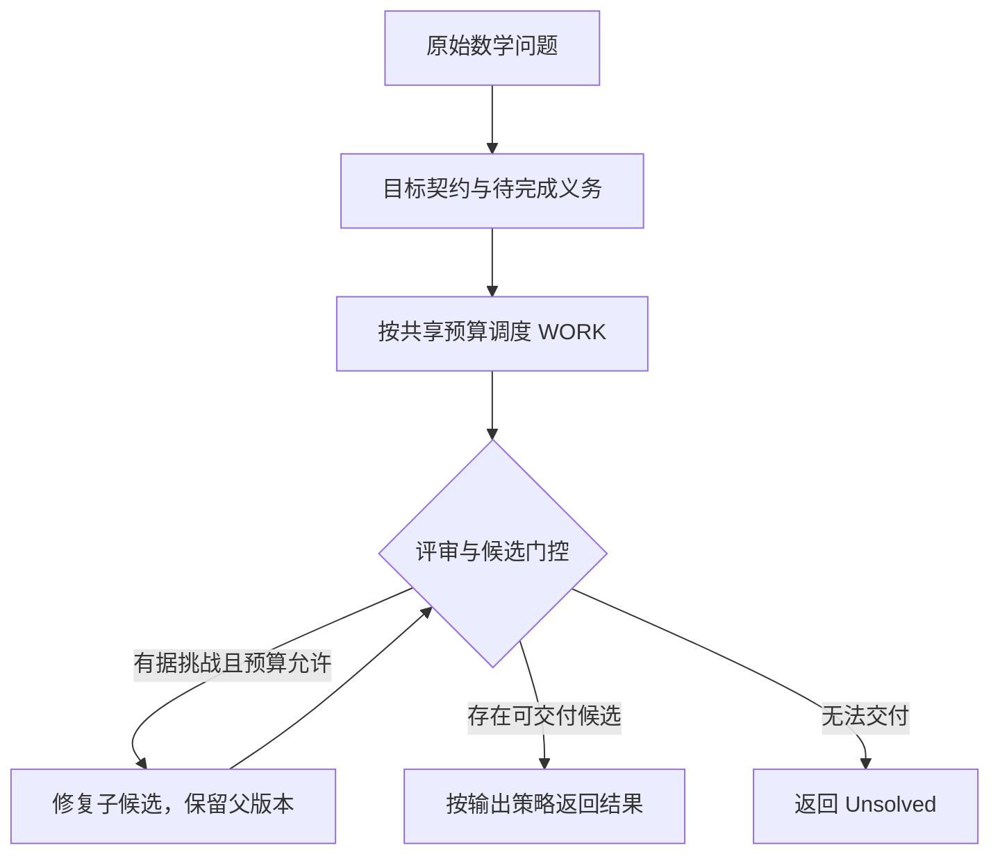

# Zygos

**ZY · 天轭**

**Axiom-Guided Math Agent → General Agent Runtime**

目标契约驱动 · 证据约束 · 有界调度 · 可逆修复

Zygos 是一个从数学推理场景出发的 Agent 运行时项目。它把问题目标、工作任务、候选答案、评审依据和调用预算放进同一条执行链，让求解过程能够追踪来源、保留历史，并在明确约束下继续或收口。

**Zygos MathAgent** 是首个领域实现。当前工作围绕数学问题理解、动态任务组织、工具与方法调用、过程评审和候选修复展开；通用 Agent Runtime 是演进方向，其他领域能力尚未验收。项目原名 **Astra**，旧名称继续用于现有技术入口、兼容标识和迁移历史。

> **当前为开发预览版本。** 本分支已使用统一 TS AgentLoop 作为 Python 官方入口的默认引擎，仍有分发、能力接入和真实环境验收工作。`engine="ts"` 表示默认实现路径，不表示已通过正式发布验收。L1 与 L2 当前均未完成。

[源码快速开始](#源码快速开始) · [接入与配置](#接入与配置) · [结果语义](#结果语义) · [开发与验证](#开发与验证) · [文档索引](#文档索引)

## 为什么做 Zygos

数学求解需要同时处理答案、论证、适用条件和解集完整性。一次工具调用成功，或者模型认为自己的答案正确，都不足以完成这些要求。

Zygos 围绕四个原则组织运行过程：

- **目标契约驱动**：保留原始题目，显式记录目标、范围、假设和待完成义务，让任务调度围绕同一个问题展开。
- **证据约束**：产物、检查与挑战绑定具体任务、范围和版本；局部检查的结论只在其支持范围内使用。
- **有界调度**：模型请求、工具效果、方法加载、评审和修复共享根预算与截止时间；新增任务不产生新的配额。
- **可逆修复**：保留父候选与历史产物，候选替换经过明确门控，依赖发生变化时使相应下游产物失效。

这里的“可逆”指保留版本、来源和替换关系，便于审计与恢复，不代表所有外部操作都有撤销能力。

## 当前能力与边界

| 方向 | 当前实现 | 尚待完成的条件 |
| --- | --- | --- |
| 统一执行入口 | `user_agent.ReasoningAgent` 默认进入 TS AgentLoop；Python Host 管理注入 client、协议与子进程 | 官方目标环境的 Node、子进程与资源限制验收 |
| 动态数学工作流 | 有界任务与路线、依赖产物、版本更新、失效传播及进度收口 | 真实模型下的数学效果与同预算对照 |
| 方法卡 | 20 张通用数学方法卡；已有按需加载到后续 WORK 的路径，新增独立 `methodCards` 资产注册组 | 默认加载开关仍为 0；新增注册能力不能单独证明全部流程已消费正文 |
| 评审与修复 | 有界 R0、R2、挑战、范围化检查及候选修复路径 | R0、修复默认关闭；整题严格数学验收未执行 |
| 数学资产 | 保留 22 个数学族 catalog 条目及 Python 算法、检查器、skills、prompts | 统一 TS 主流程的全量算法执行与结果消费证据尚未齐备 |
| 运行底座 | 事件日志、上下文投影与回放、请求责任、截断屏障、受控 checkpoint/resume | 目标环境验收与完整迁移结案 |
| 分发 | 仓库内提供预编译 Node bundle、schema 和构建清单；wheel 已包含 TS 运行链路并在本地 clean-venv 冒烟通过 | 正式目标环境的 Node/子进程验收（B2）仍未完成 |
| 交互展示 | 当前对外使用 Python 接口 | Web / Notebook 交互 Demo 和比赛要求的多智能体协作展示待验收 |

本地回归、资产哈希、模型准确率、目标环境验收和正式发布是不同层面的证据。当前状态与未决项见 [GATEBOARD](docs/GATEBOARD.md) 和 [RELEASE_BLOCKERS](docs/RELEASE_BLOCKERS.md)。

## 架构

官方调用接口保持为：

```python
user_agent.ReasoningAgent(client=client).solve(problem, metadata)
```

Python Host 启动一个 Node stdio 运行时，由统一的 `runAgentLoop` 调度 M1—M5。模型访问始终经过调用方注入的公共 client；CLI 或未来界面也应复用这条运行链。

| 层 / 模块 | 当前代码位置 | 主要职责 |
| --- | --- | --- |
| 官方入口 | [user_agent.py](user_agent.py) | 保持 `ReasoningAgent` / `solve` 接口，选择明确的引擎 |
| Python Host | [python/astra_bridge](python/astra_bridge) | 公共 client 适配、协议校验、子进程生命周期、工具与资产准入 |
| TS 组合根 | [apps/stdio-runtime/src/agent-loop.ts](apps/stdio-runtime/src/agent-loop.ts) | 在同一根会话中组织任务、WORK、评审、修复及最终选择 |
| M1 · 目标契约 | [packages/math-contract](packages/math-contract) | 题目身份、目标、义务、任务及依赖账本 |
| M2 · 调用准入 | [packages/math-gateway](packages/math-gateway) | 请求绑定、调用状态与调度准入 |
| M3 · 工作单元 | [packages/math-workunit](packages/math-workunit) | 构建上下文，接收版本化工作产物与依赖 |
| M4 · 过程评审 | [packages/math-review](packages/math-review) | 计划与候选评审、问题与挑战记录 |
| M5 · 数学审计 | [packages/math-audit](packages/math-audit) | 检查依据的适用范围、修复替换条件和最终输出策略 |
| Runtime Core | [packages/runtime-core](packages/runtime-core) | 根预算、事件、上下文投影和运行生命周期 |
| 协议 | [packages/protocol](packages/protocol) | 跨模块类型、Host 协议与 schema |
| 数学领域资产 | [mathagent](mathagent)、[math_families](math_families) | 方法知识、受信算法、检查器及保留的 Python 实现 |
| Web 观测控制台 | [apps/web-demo](apps/web-demo) ([完整说明](apps/web-demo/README.md)) | 挑战杯可观测驾驶舱、7 标签审计详情与确定性时间胶囊回放 |
| Web BFF 服务 | [python/astra_web](python/astra_web) | Starlette 只读与实时 BFF，数据归档索引、静态托管与 SSE 广播通道 |
| Web 共享契约 | [packages/web-contract](packages/web-contract) | 前后端强类型 DTO、JSON Schema 与代码生成映射 |

一次求解的主要控制关系如下。分支是否触发还取决于配置、预算和实际收到的证据：



R0 是计划阶段的有界评审，R2 面向实际候选；S1 / S2 / S3 分别承担问题与检查范围对应、局部修复关系和最终候选选择。模型评审是意见，工具回执是观察，两者都不能自动把整题升级为“数学已验证”。

## 源码快速开始

### 环境要求

| 依赖 | 要求 |
| --- | --- |
| Python | `>=3.10`，见 [pyproject.toml](pyproject.toml) |
| Node.js | 仓库开发配置锁定 `24.7.0`，运行 TS 引擎需要 Node |
| Python 运行依赖 | SymPy、NumPy、SciPy、Requests，范围见 [requirements.txt](requirements.txt) |
| pnpm / TypeScript | 修改、构建 TS 时使用；当前声明为 pnpm `11.7.0`、TypeScript `6.0.3` |
| 公共 client | 真实求解时由平台或调用方注入；离线检查可使用模拟 client |

使用仓库已经提供的 bundle 时，不需要在求解时运行 npm、pnpm 或 tsc。目标比赛平台是否允许相应 Node 与子进程能力，仍需单独验证。

### 获取并准备源码

以下命令面向 Bash / POSIX shell，从当前开发分支开始：

```bash
git clone --branch feat/v4-dynamic-workflows https://github.com/3294682143-gif/astra-refactored.git
cd astra-refactored

python -m venv .venv
. .venv/bin/activate
python -m pip install -r requirements.txt

node --version
python scripts/build_release_manifest.py --verify release/BUILD_MANIFEST.json
```

清单检查成功时输出 `VERIFY_OK`。它校验记录的文件哈希和源码祖先关系，不调用模型，也不证明数学答案正确。浅克隆缺少清单引用的祖先提交时，需要先补齐对应 Git 历史。

`pip install .` 生成的 wheel 已包含 `python/astra_bridge`、预编译 bundle、schema 和协议资源；本地 clean-venv、源码目录外的 `engine="ts"` 冒烟已通过。正式目标环境的 Node/子进程验收仍需单独完成（B2）。

### 离线入口冒烟

安装上述 Python 依赖后，可用以下模拟 client 检查 Python → Node → 结构化返回的路径。它主动报告未解，不访问模型服务，不用于测量解题能力：

```bash
python - <<'PY'
import json
from user_agent import ReasoningAgent

class OfflineClient:
    def chat(self, messages, temperature=0.2, max_tokens=8192):
        return {
            "choices": [{
                "index": 0,
                "finish_reason": "stop",
                "message": {
                    "role": "assistant",
                    "content": json.dumps({
                        "action": "unsolved",
                        "reason": "offline smoke test",
                    }),
                },
            }],
        }

result = ReasoningAgent(client=OfflineClient()).solve("Compute 2+2", {})
assert result["engine"] == "ts"
assert result["status"] == "unsolved"
assert result["childReaped"] is True
assert "code" not in result, result
print(json.dumps(result, ensure_ascii=False, indent=2))
PY
```

真实模型调用、工具执行和数学正确性应分别使用后续测试与评测流程验证。

## 接入与配置

### 官方接口与引擎

```python
from user_agent import ReasoningAgent

def solve_with_client(client, problem: str, metadata=None):
    agent = ReasoningAgent(client=client)  # 默认 engine="ts"
    return agent.solve(problem, metadata)
```

`client` 由外部提供。`problem` 是非空题目字符串；当前 TS 入口最多接收 8192 个 Unicode 码点。`metadata` 保留为官方兼容参数，不把标准答案或题号当作求解依据。

| 引擎参数 | 当前含义 |
| --- | --- |
| `engine="ts"` | **默认**。通过 Python Host 运行统一 TS AgentLoop |
| `engine="lite"` | 显式选择实验性轻量 typed-action 路径 |
| `engine="legacy"` | 显式选择保留的原 Python Controller 路径 |

未知引擎和不支持的参数会被拒绝。TS 入口失败时返回明确错误或未解结果，不会静默切换到其他引擎。不同引擎的可选参数并不通用。

### 公共 client 契约

当前 TS Host 使用同步公共方法：

```python
client.chat(
    messages=messages,
    temperature=0.2,
    max_tokens=8192,
)
```

client 适配层需要保留公开的响应正文和完成信号。典型响应形状为：

```python
{
    "choices": [{
        "index": 0,
        "finish_reason": "stop",
        "message": {
            "role": "assistant",
            "content": "...由当前阶段要求的结构化响应文本...",
        },
    }],
    "usage": {
        "prompt_tokens": 100,
        "completion_tokens": 50,
        "total_tokens": 150,
    },
}
```

上述数值仅示意字段形状。`usage` 缺失时成本保持未知。`stop` / `end_turn` 表示明确结束；`length` 表示截断；裸字符串或缺少 `finish_reason` 的响应被保守处理为完成状态未知。模型需要遵守运行时发出的阶段协议，普通文本答案不能替代有效的工作产物。

Host 不从环境中读取模型密钥，也不另建模型请求通道。真实 client 的字段、限流、输出能力和完成语义应按 [REAL_API_CAPABILITIES](docs/REAL_API_CAPABILITIES.md) 验证。

### TS 参数与默认值

下面列出当前 `AgentRuntime` 的主要构造参数。范围是实现允许的上界，**不是官方比赛额度**。

| Python 参数 | 默认值 | 允许范围 / 含义 |
| --- | --- | --- |
| `max_model_calls` | `8` | `0..256`，根会话模型调用上限 |
| `max_work_units` | `4` | `1..64`，工作单元上限 |
| `max_effects` | `1` | `0..2`，工具执行与方法加载共享的效果额度 |
| `max_reviews` | `1` | `0..1`，R2 评审额度 |
| `max_method_loads` | `0` | `0..1`，方法卡加载额度 |
| `max_repairs` | `0` | `0..1`，候选修复额度 |
| `max_r0` | `0` | `0..1`，R0 计划评审额度 |
| `problem_seconds` | `600` | `0 < 值 <= 3600`，单题根截止时间，包含启动与收口 |
| `policy` | `"BEST_EFFORT"` | `"BEST_EFFORT"` 或 `"STRICT"` |
| `derive_budget` | `False` | 是否启用内部任务预算推导；只能在 Host 根上限内分配，不会扩大上限 |
| `node` | `"node"` | 受信的 Node 可执行文件名或路径 |
| `mode` | `"platform"` | `"platform"`、`"local"` 或 `"shared_public"` |

配置定义见 [agent_runtime.py](python/astra_bridge/agent_runtime.py)，跨进程约束见 [agent-host-v13.schema.json](packages/protocol/schema/agent-host-v13.schema.json)。

默认配置是保守预览 profile：**方法卡、R0 和修复均关闭**。如需测试方法卡加载，可显式构造：

```python
def create_method_enabled_agent(client):
    return ReasoningAgent(
        client=client,
        engine="ts",
        max_method_loads=1,
    )
```

R0 与修复分别通过 `max_r0=1`、`max_repairs=1` 启用。`max_repairs=1` 还允许在 WorkPacket 形状被控制 schema 拒绝后做一次同一任务的 schema-repair 回合；默认 0 保持 fail-closed。开启开关只授予调用额度；实际触发还需要满足任务状态、后续工作与评审预留、证据和剩余时间条件。方法加载与工具执行共用 `max_effects`，每题无需强制加载卡片。

真实运行应在已确定的预算内配置全部参数。开发默认的 600 秒只是为了给真实模型留出完成时间，不代表官方额度。固定对照实验配置见 [RUN_CONFIG_LOCK](docs/RUN_CONFIG_LOCK.md)，它与默认预览 profile 分开管理。

## 结果语义

`solve` 返回可 JSON 序列化的字典。以下是候选结果的字段节选，示意值不代表评测成绩：

```json
{
  "engine": "ts",
  "status": "candidate",
  "final_response": "4",
  "candidate_verified": false,
  "strictAcceptance": "NOT_PERFORMED",
  "mode": "TS_PREVIEW",
  "targetEnvironment": "TARGET_UNVERIFIED"
}
```

| 字段 | 解释 |
| --- | --- |
| `final_response` | 对外交付的答案或未解文本；TS 未解结果使用 `"Unsolved."` |
| `status` | `candidate` 或 `unsolved`，表示是否交付候选 |
| `candidate_verified` | 当前 TS 入口固定为 `false`，不宣称整题已完成严格数学验证 |
| `strictAcceptance` | 当前为 `NOT_PERFORMED` |
| `stopReason` / `reason` | 调度停止与候选选择原因；错误路径还可能包含固定 `code` |
| `unresolvedObligations` | 仍未解决的数学义务 |
| `trace` | 脱敏控制事件，用于查看状态变化与来源；不是完整证明文本 |
| `metrics` | 实际 client 调用、逻辑调用、效果、评审、方法加载及已知 / 未知用量等指标 |
| `finishReason` | 公共响应的完成信号 |
| `childReaped` | 子进程清理状态；不表示远端模型请求已取消 |

`BEST_EFFORT` 可以交付符合来源与输出条件、但仍未严格验证的候选。`STRICT` 会保留其验证要求；当前 TS 入口不提供整题验证成功状态，使用 STRICT 可能得到未解结果。

数学检查需要分别判断“给出的值都是根”“全部根已找全”“符合原式定义域”。检查通过、失败和无法判断必须区分；超出支持范围的表达式或完整性问题不能因工具正常返回而视为通过。

`REVISED_CANDIDATE` 表示候选经过修复门控后被替换，仍不等于 `candidate_verified=true`。面向用户的解答与论证来自实际交付内容，不应将控制 trace 或模型自评展示为数学证明。

## 数学资源与工具

### 通用方法卡

[general_v11](mathagent/resources/general_v11) 保留 **20 张通用数学方法卡**，权威目录为 [methods.json](mathagent/resources/general_v11/data/methods.json)。它们提供方法选择、前提检查和证明组织建议，例如 `domain-equivalence`、`proof-counterexamples`。

当前已有 `method.catalog → method.load → WORK` 接线。目录提供 ID 与元数据，加载时按注册 ID 读取正文并校验哈希，正文进入后续工作上下文。卡片属于建议性知识，不是标准答案或已经证明的数学前提。

新增 Host 资产组的代码标识是 **`methodCards`**，按 `methods.json` 中的 ID、路径与正文哈希寻址。这个注册组与 `mathFamilies` 独立，不要求方法卡与算法族一一对应。`asset.scoped` 的资产描述符也不等同于 `method.load` 的正文加载回执。

### 数学族与检查器

| 资源 | 当前盘点 | 含义 |
| --- | ---: | --- |
| `general_v11` 方法卡 | 20 张 | 方法知识与选路指导 |
| `math_families/catalog.json` | 22 个条目 | 具名数学算法族目录 |
| `math_families/` | 60 个文件 | Python、Markdown、JSON 文件总数，并非 60 个数学族 |

数学族包括符号代数、符号微积分、数位 DP、转移矩阵、计数、数论结构、几何计算等，具体参数与支持范围见 [catalog](math_families/catalog.json) 和 [math_families README](math_families/README.md)。

当前 Host 可对注册资产做范围化、版本化和完整性检查；`scoped_asset_call` 返回描述符，本身不执行算法。算法文件保留、注册成功和哈希通过不能直接证明统一 TS 主流程已经调用算法并消费结果。完整接入仍按 [迁移审计](docs/MIGRATION_AUDIT.md) 与 [能力矩阵](docs/CAPABILITY_MATRIX.csv) 验收。

### 当前通用动作工具

TS / lite 的通用工具动作入口当前限定为：

| 工具名 | 作用 |
| --- | --- |
| `polynomial_expand_coefficients` | 在有界输入上展开多项式并返回系数 |
| `linear_system_solution_set` | 在声明的域与精确输入范围内求线性系统解集 |
| `exact_check_expr` | 有界符号检查：三角化简、极大子式、代数扩域因式分解、定积分、极限、密度归一化 |
| `bounded_enumeration` | 对显式有限对象表或笛卡尔积做穷举 k-子集计数 |

这些工具经过已有注册执行器的输入验证、隔离、截止时间与审计路径。工具结果是范围化程序观察，不能自动证明原题全部义务。

## 运行控制与恢复

一次求解使用同一个根截止时间和预算。新增任务、方法请求、重做或修复不刷新它们；相同请求的缓存复用也不建立新会话额度。

运行时区分请求意图、准入、派发、本地返回和远端终态。超时或缺少完成信号可能留下 `OUTCOME_UNKNOWN`：停止本地等待不等于远端已停止，运行时不会自动重放未知结果的请求。

TS 公开 `solve` 接受 `resume_checkpoint` 参数。当前受控恢复用于 `local` / `shared_public` 模式，校验题目、契约、事件序列、上下文及已用预算；已完成工作不应重跑，预算只能延续或收紧。checkpoint 导出仍位于内部 `AgentRuntime.export_checkpoint`，尚未封装为稳定的顶层导出命令。

恢复行为与拒绝案例见 [checkpoint/resume 测试](tests/e2e/test_ts_g7_checkpoint_resume.py)，运行底座说明见 [G4_RUNTIME_HARDENING](docs/G4_RUNTIME_HARDENING.md)。

### 执行边界

- 问题、方法卡和工具输出作为数据处理，不能扩大模型或工具权限。
- 受信固定算法与模型生成代码使用不同执行路径。
- 模型生成 Python 需要单独配置、在实际安装路径验收的 WASI profile。
- 本仓库不附带 WASI 二进制或已获平台认可的安装 profile；缺失时拒绝相应能力，不回退到宿主 Python。
- 本机 sandbox 测试、安装可复现性和比赛平台许可分别记录。

WASI 相关说明见 [generated_python_wasi.md](docs/generated_python_wasi.md) 和 [INSTALL.md](INSTALL.md)。其中的历史安装步骤需要结合当前仓库资源与平台条件核对。

## 开发与验证

### 构建与离线回归

先按 [package.json](package.json) 和 [pnpm-lock.yaml](pnpm-lock.yaml) 准备对应工具链与依赖。锁定依赖已在缓存中时，可从仓库根目录执行：

```bash
python -m pip install -r requirements-dev.txt
pnpm install --offline --frozen-lockfile --ignore-scripts

node node_modules/typescript/bin/tsc -b
node --test packages/protocol/dist/tests/*.test.js apps/stdio-runtime/dist/tests/*.test.js

python -m pytest -q
```

离线安装若因缺少缓存而失败，应先在授权环境补齐锁定依赖，再继续构建。安装未成功时，不依赖脚本自动安装或更换版本。

### 源码入口与预编译入口

Python Host 默认启动 [release/stdio-runtime.bundle.mjs](release/stdio-runtime.bundle.mjs)，并使用相应协议资源。修改 TS 源码、运行 `tsc -b` 后，默认 bundle 不会自动随之更新。

开发时可显式选择工作区编译入口：

```bash
ASTRA_STDIO_RUNTIME=dev python -m pytest -q tests/e2e/test_ts_entry.py
```

该入口依赖已构建的 `dist` 与工作区依赖链接。发布前须重新构建并验收实际 bundle、对应 schema 和清单，再使用默认入口完成验证。`build_release_manifest.py` 只生成或验证清单，不负责重新编译或打包。

### 重点验证入口

| 验证范围 | 文件 / 命令 |
| --- | --- |
| 预编译文件与资产清单 | `python scripts/build_release_manifest.py --verify release/BUILD_MANIFEST.json` |
| Python → Host → Node 入口及拒绝行为 | [test_ts_entry.py](tests/e2e/test_ts_entry.py)、[test_ts_entry_safety.py](tests/e2e/test_ts_entry_safety.py) |
| 方法卡实际加载与 WORK 消费 | [test_ts_methods.py](tests/e2e/test_ts_methods.py)、[test_ts_methods_safety.py](tests/e2e/test_ts_methods_safety.py) |
| 独立 `methodCards` 注册与范围化寻址 | [test_g7_methodcards.py](tests/bridge/test_g7_methodcards.py) |
| 数学解集验收边界 | [agent-semantics-solutions.test.ts](apps/stdio-runtime/tests/agent-semantics-solutions.test.ts) |
| 有据修复公开入口 | [test_ts_g3_flagship.py](tests/e2e/test_ts_g3_flagship.py) |
| 预编译 bundle 运行 | [test_ts_g6_release.py](tests/e2e/test_ts_g6_release.py) |
| checkpoint/resume | [test_ts_g7_checkpoint_resume.py](tests/e2e/test_ts_g7_checkpoint_resume.py) |

离线 E2E 中可使用模拟模型响应，同时运行真实 Host、Node 子进程和部分受信工具。这证明对应工程行为，不提供真实模型准确率结论。WASI 等必要测试的跳过也不计作验收通过。

## 赛题目标与发布路线

本项目面向 **XH-202627《基于 Intern-S1 的数学智能体设计与推理创新》**。赛题要求包括自然语言数学理解、自主求解、推理解释与结构化 JSON；决赛进一步要求多智能体协作与可交互 Web / Notebook Demo。

赛题文件指定 **Intern-S1 API**。仓库中已有 S2 相关适配、开发记录与对照评测契约，两者需要分开说明；具体参赛模型与使用方式以正式规则和平台确认为准，开发中的 API 冒烟不代表完成了官方 client 或比赛环境验收。

当前路线分为两个验收层次：

| 层次 | 目标 | 当前状态 |
| --- | --- | --- |
| L1 | 比赛可用的完整 MathAgent | `NOT_COMPLETE` |
| L2 | 冻结 RC2 能力的全量等价与迁移结案 | `NOT_COMPLETE` |

后续工作包括：

1. 补齐方法卡、数学资产的正式主流程接入和行为证据，完成内部迁移收口。
2. 完成真实分发包与源码目录外安装运行验证。
3. 完成官方注入 client、目标环境、必要 sandbox 与冻结题集同预算对照。
4. 完成交互 Demo 与多智能体协作展示的独立验收。
5. 进入集中命名迁移，按实际通过的发布门槛交付 Zygos 正式版本。

真实数学对照使用冻结题集、基线、预算与裁判，分别记录准确率、由对变错 / 由错变对、未解、缺分支、修复保留、截断、耗时及已知 / 未知成本。当前没有可据此发布的完整真实模型对照结论，见 [MATH_AB_REPORT](docs/MATH_AB_REPORT.md)。

迁移台账按源文件记录状态，其关闭比例不等于功能完成率或数学题正确率。

## 品牌与技术命名

正式品牌已经确定为 **Zygos（ZY，天轭）**；“天秤之轭”为中文品牌释义。

当前处于 **阶段 A：品牌统一与内部整合**。为保持运行与历史追溯，技术名称暂按现有实现使用：

| 对象 | 当前可用标识 | 阶段 B 目标 |
| --- | --- | --- |
| 仓库 | `astra-refactored` | `zygos` |
| TypeScript 包 | `@astra/*` | `@zygos/*` |
| Runtime 核心包 | `@astra/runtime-core` | `@zygos/runtime-core` |
| Python 宿主 | `mathagent`、`python.astra_bridge` | `zygos` |
| 官方兼容入口 | `user_agent.ReasoningAgent` | 保持兼容 |
| 引擎 | `engine="ts"` | `engine="zygos"`，保留 `ts` 兼容别名 |
| 环境变量 | 现有 `ASTRA_*` | `ZYGOS_*` |
| CLI | 尚无正式 CLI | `zy` |

阶段 B 在运行链、真实 API、回归与分发验证满足进入条件后集中执行。目标命名空间、仓库名与分发权限尚需实际核验；Python 导入名和 PyPI 分发项目名分别确认。

因此，当前安装与运行说明仍使用实际存在的名称，`zy`、`engine="zygos"`、`pip install zygos` 与 `@zygos/*` 尚未作为可用入口交付。命名契约与兼容策略见 [NAMING](docs/NAMING.md)、[RENAME_MIGRATION](docs/RENAME_MIGRATION.md) 和 [ADR-011](docs/adr/ADR-011-zygos-brand-and-two-phase-migration.md)。

## 文档索引

| 阅读目的 | 文档 |
| --- | --- |
| 当前门槛与发布阻断 | [GATEBOARD](docs/GATEBOARD.md)、[RELEASE_BLOCKERS](docs/RELEASE_BLOCKERS.md) |
| 品牌、命名和迁移策略 | [NAMING](docs/NAMING.md)、[RENAME_MIGRATION](docs/RENAME_MIGRATION.md) |
| 主循环设计与 Host 接入历史 | [UNIFIED_TS_AGENT_LOOP](docs/UNIFIED_TS_AGENT_LOOP.md)、[TS_ENGINE_ENTRY](docs/TS_ENGINE_ENTRY.md) |
| 动态任务、依赖与产物版本 | [G2_DYNAMIC_ROUTES](docs/G2_DYNAMIC_ROUTES.md)、[G2_DEPENDENT_CHAIN](docs/G2_DEPENDENT_CHAIN.md)、[G2_ARTIFACT_REDO](docs/G2_ARTIFACT_REDO.md) |
| 方法加载与有据修复 | [G2_METHOD_BRIDGE](docs/G2_METHOD_BRIDGE.md)、[P4_EVIDENCE_REVISION](docs/P4_EVIDENCE_REVISION.md) |
| 运行时机制 | [G4_RUNTIME_HARDENING](docs/G4_RUNTIME_HARDENING.md) |
| 源码身份与迁移证据 | [SOURCE_LOCK](docs/SOURCE_LOCK.md)、[MIGRATION_AUDIT](docs/MIGRATION_AUDIT.md)、[MIGRATION_MATRIX](docs/MIGRATION_MATRIX.csv)、[CAPABILITY_MATRIX](docs/CAPABILITY_MATRIX.csv) |
| 模型接口与对照评测 | [REAL_API_CAPABILITIES](docs/REAL_API_CAPABILITIES.md)、[RUN_CONFIG_LOCK](docs/RUN_CONFIG_LOCK.md)、[MATH_AB_REPORT](docs/MATH_AB_REPORT.md) |
| 安装与可选 WASI | [INSTALL](INSTALL.md)、[generated_python_wasi](docs/generated_python_wasi.md) |
| 原 Python 架构来源 | [python-full-rc2-frozen 分支](https://github.com/3294682143-gif/astra-refactored/tree/python-full-rc2-frozen) |
| 贡献约定 | [AGENTS.md](AGENTS.md) |

P0—P4 与部分接入文档保留了当时的默认值和阶段限制，适合追溯实现过程。当前入口以 [user_agent.py](user_agent.py)、配置以 [AgentRuntime](python/astra_bridge/agent_runtime.py) 和实际清单为准，阶段变更参照对应 ADR。

## 贡献与使用说明

提交变更前请阅读 [AGENTS.md](AGENTS.md)。保持官方接口、注入式模型访问、根预算、未知请求责任和执行隔离；保留冻结基线与来源证据，并记录实际运行的检查及其结果。

仓库不接收凭据、个人安装配置、私有运行日志、标准答案或针对评测题制作的题卡。

当前仓库未提供项目级 `LICENSE` 文件，公开源码本身不构成额外的许可声明；第三方依赖与来源材料按各自许可和署名要求处理。
