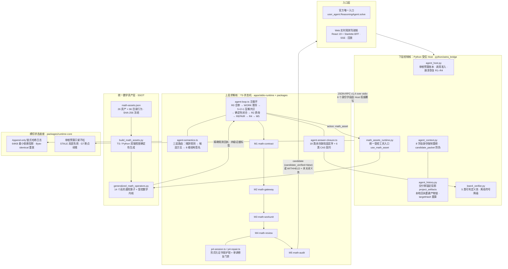

# 天轭（Zygos）——基于书生大模型的双核可信数学智能体系统

**🏆 官方测试：96 分**

**目标契约驱动 · 证据受控 · 有界调度 · 可逆修复的可核查数学推理运行时**

> **赛题**：第十五届“挑战杯”中国青年科技创新“揭榜挂帅”擂台赛 · **XH-202627《基于 Intern-S1 的数学智能体设计与推理创新》**（上海人工智能实验室）  
> **代码基线**：核心 TS 引擎基线为最终提交版 **v15 · `7d4dfb5`**（分支 `fix/closure-source-trust`）；当前 **`feat/web-demo-v15`** 分支在保持 `7d4dfb5` TS 引擎零改动的前提下，集成最新 React 19 Web 驾驶舱、批量评测工作台与一键启动能力。  
> **模型接口**：对齐赛题 `Intern-S1` 公共 `client.chat` 契约，兼容书生 S2 正式版（`intern-s2`，支持书生·浦语与书生·端砚端点）。  
> **红线声明**：协议与 Web 层均硬锁 **`candidate_verified=false`**、**`strictAcceptance=NOT_PERFORMED`**——系统交付的是经受控算子与审查门禁筛选的**机器候选解**，不等于形式化证明。

[痛点与破题](#一痛点剖析与破题思路) · [系统架构](#二双核异构可信系统架构) · [三大创新](#三三大核心创新机制) · [Web 驾驶舱](#四web-实时观测驾驶舱) · [快速开始](#六快速开始与运行方式) · [目录与文档](#七仓库目录导览与文档索引)

---

## 一、痛点剖析与破题思路

通用大模型与常规提示词智能体在求解高阶数学题（覆盖抽象代数、拓扑、微分方程、数理统计、离散数学等 18 个子领域）时，核心困境是**“过程看似流畅、一查就出错”**。根本原因在于**基础模型单次生成不可全信，且不能让模型既当“运动员（做推导）”又当“裁判员（管预算、身份与放行）”**。

| 核心痛点 | 传统单核智能体典型失效 | 天轭（Zygos）破题机制 |
| :--- | :--- | :--- |
| **规划与求解脱节** | 单轮直写易漏定义域、量词约束与多问子项；仅靠表面关键词匹配工具，无法识别底层数学结构。 | **创新一 · 先立合同再动工**：M1 目标契约与义务 DAG → R0 三方独立会审 → **8 维数学结构签名三层路由**。 |
| **长程失控与修订牵连** | 前序引理算错后，后续步骤沿用旧错或全盘推翻导致 Token 爆炸，缺乏产物版本与局部失效隔离。 | **创新三 · 链式哈希状态底座**：64KB 最小依赖闭包投影 + 产物版本化 + **`STALE` 下游闭包局部精确失效** + G7 断点续推。 |
| **结果不可靠与校验错位** | 常规多数投票遇同义异形写法即散票，遇高频陷阱则“错解占多数”；缺乏精确算子反制，甚至拿抽样冒充证明。 | **创新二/三 · 5+2+1 共识 + 统一资产 + 双锁门禁**：跨语言规范键计票 + **2 路独立锚定审计推翻错票** + 26×96 精确算子 + **证书保护锁与单调修复门禁**。 |

---

## 二、双核异构可信系统架构

### 2.1 “运动员—裁判员”跨进程物理隔离

Zygos 将推理编排与安全控制物理拆分为两个独立进程，通过 **JSON-RPC v1.4 over stdio** 协作：
- **上层求解核（TypeScript 状态机，“运动员”）**：位于 [apps/stdio-runtime](apps/stdio-runtime) 与 [packages](packages)，纯状态机运行，无网络 I/O、无密钥权限、无时钟篡改权，专注 M1–M5 推理编排、结构路由与闭合检查。
- **下层控制核（Python 受信 Host，“裁判员”）**：位于 [python/astra_bridge](python/astra_bridge)，经 [user_agent.py](user_agent.py) 暴露唯一入口 `ReasoningAgent(client=...).solve(problem, metadata)`，独占 `client.chat` 通道，掌管预算账本、Schema 校验、受控算子执行与终态裁决。

> 独立架构图详见 [ARCHITECTURE.md](ARCHITECTURE.md)。



主求解执行链：

```text
原始题 → M1 目标契约(义务/DAG) → R0 三角色会审 → WORK 长程推导(64KB 依赖投影)
  → 5+2+1 独立盲解共识 → 确定性闭合 + 6 类声明式 CAS 契约 → R2 缺陷质询
  → REPAIR 有界修复(双锁门禁) → R4 复核 → M5 projectProtectedFinal
  → candidate (candidate_verified=false) 或 WITHHELD + 未关闭义务清单
```

### 2.2 M1–M5 模块化分工与跨进程防伪机制

| 模块 | 源码包 | 核心职责与关键机制 |
| :---: | :--- | :--- |
| **M1** | [packages/math-contract](packages/math-contract) | **目标契约编译**：抽取求解目标、定义域、量词与多问子项，构建义务依赖 DAG，支持受控重修 `reviseGoals`（`contractVersion: 1\|2`）。 |
| **M2** | [packages/math-gateway](packages/math-gateway) | **调用准入控制**：校验上下文 Schema 版本、根预算余额、4096 Unicode 码点上限与请求签名。 |
| **M3** | [packages/math-workunit](packages/math-workunit) | **工作单元执行**：管理 `p2a-work-v1` 推导产物包、版本号、依赖引用与 `STALE` 传播。 |
| **M4** | [packages/math-review](packages/math-review) | **过程评审管理**：编排 R0/R2/R4 审阅流程，由 [p4-session.ts](packages/math-review/src/p4-session.ts) 维护**形式化证书保护锁**。 |
| **M5** | [packages/math-audit](packages/math-audit) | **终态审计裁决**：由 [p4-repair.ts](packages/math-audit/src/p4-repair.ts) 执行**单调修复门禁**与 `projectProtectedFinal`，核验多选/多问义务全覆盖。 |

**两项关键跨进程防伪设计**：
1. **8 字段权威身份重绑**（[agent_context.py](python/astra_bridge/agent_context.py)）：跨 JSON-RPC 传输的 `sessionId`、`problemHash`、`contractVersion`、`taskId`、`goalId`、`scopeId`、`routeId`、`sourceRequestId` 均忽略模型自称值，由 Python Host 按本地派发台账强制覆写，阻断身份伪造与跨任务串扰。
2. **交付侧锚定投影**（[agent_history.py](python/astra_bridge/agent_history.py)，`project_artifacts(anchor_source_id)`，Commit `0b6497e` → `3320212`）：Host 以 TS 状态机终态明确声明的 `anchor_source_id` 为唯一交付锚点，放弃独立加冕 front-runner，但**仍基于 Host 本地保存的原始回执逐行重建产物并重算 `candidate_packet` 与 `targetHash`**。既保持 100% 防伪校验，又将百题长跑中的双侧协议分歧率降至 **0%**。

### 2.3 五条硬不变量与单根有界预算

所有模型调用、工具效应、方法卡加载与审修共享**单一根预算账本**（不可通过派生子任务刷新配额，预算只紧不松），由跨端测试锁死五条硬不变量：
1. **统一记录**：模型上下文始终是 Append-only 链式哈希日志的确定性投影；
2. **异常拒绝（Fail-Closed）**：字段越界、哈希失配或未登记工具调用在准入阶段即拦截；
3. **预算受限**：请求一经派发立即扣减配额（R3），重启恢复绝不增发配额；
4. **未知终态责任**：超时或断连记为 `OUTCOME_UNKNOWN`，绝不自动重放未知副作用请求；超长输出（`>4096` 码点）优雅截断而非崩溃；
5. **边界清晰**：防 PID 复用（R1）、归档先落盘后提交（R2）、`dispatchState` 严格区分系统故障与模型未解（R4），且 `candidate_verified` 恒为 `false`。

---

## 三、三大核心创新机制

### 3.1 创新一：契约驱动的任务拆解、三层路由与有界排程

- **M1 目标契约与义务 DAG**：先解析题面四要素（目标、定义域、量词、子问），将子目标编译为必须闭合的 `obligationId` 清单及任务 DAG；M5 终审若发现叶子义务未闭合即拒绝草率交付。
- **R0 三方独立会审**：由 `MEANING`（题意与边界）、`METHOD`（定理与定义域适用性）、`TASK_TOOL`（任务粒度与算子入参）三个独立角色分别给出判定与题面原文依据：任一角色缺失/不合规则为 `UNKNOWN`；任一角色报出缺陷则记为 `ISSUES` 并触发至多 1 次 `reviseGoals`（升版至 `v2`）；三方均确认无误（`NO_ISSUE`）方放行进入 `WORK`。
- **8 维数学结构签名三层路由**（[agent-semantics.ts](apps/stdio-runtime/src/agent-semantics.ts)）：
  1. **第一层（显式措辞规则 `semanticToolRoute`）**：针对明确算子指征直接锁定目标资产与参数模板，未命中诚实返回 `null`；
  2. **第二层（受限候选方法卡 `semanticMethodRoute`）**：融合工具增益打分，严格截断保留 **≤ 3 个候选方法**，避免注意力稀释；
  3. **第三层（8 维数学结构签名兜底 `extractMathStructuralSignature`）**：按底层结构本质泛化挂载资产：

  | 维度 | 结构签名字段 | 识别的底层数学结构 | 典型挂载资产 / 算子 |
  | :---: | :--- | :--- | :--- |
  | 1 | `hasPermutationCycles` | 对称群 $S_n$、不相交轮换、共轭字 | `math.algebraic-structures:permutation_word_eval` |
  | 2 | `hasLaurentOrParametricMatrixDet` | Laurent 多项式矩阵、纽结 Alexander 多项式、Fitting 理想 | `math.linear-algebra:maximal_minors` / `laurent_fitting_gcd` |
  | 3 | `hasRecurrenceOrMarkovStationary` | 线性递推、特征方程、马氏链平稳分布 / 调和函数 | `characteristic_general_solution` / 线性系统求解 |
  | 4 | `hasStatisticalInference` | MLE、Fisher 信息、分位数、置信区间、OLS/ANOVA | `sampling_distribution_quantiles` / `mle_fisher_score` |
  | 5 | `hasTopologyOrManifoldAxioms` | 分离公理 $T_{0\text{–}4}$、紧致连通、单纯复形同调 / 基本群 | `finite_topology_axioms` / `simplicial_homology` |
  | 6 | `hasDifferentialOperatorOrODE` | 圆周/平面拉普拉斯算子、联络形式、常微分方程 | `circle_laplacian` / `planar_laplacian` |
  | 7 | `hasNumberTheoryCongruence` | 模同余方程、二次丢番图方程、原根、二次剩余 | `quadratic_diophantine` / `symbolic_diophantine` |
  | 8 | `hasFormalProofOrCounterexample` | 多命题真值判定、有界反例搜索、布尔重言式 / SAT | `lean4_obligation` / `bounded_counterexample_search` |

- **DAG 动态排程与 G2 停滞让渡**：主循环 [agent-loop.ts](apps/stdio-runtime/src/agent-loop.ts) 每轮从就绪队列（前置均 `ACTIVE`）按根预算余额派发任务；单一路线连续停滞时触发 G2 停滞让渡切换备用路线。

### 3.2 创新二：5+2+1 多智能体盲解共识与单一事实源统一数学资产

#### 1) 5+2+1 去相关盲解与锚定纠偏

拒绝同提示词重复采样，采用物理隔离的 **5 独立盲解 + 2 锚定审计 + 1 证书自检**：
- **5 路正交视角盲解（Lens Rotation）**：正向推导、逆向回代、换路重构、隐含假设查漏、边界特例退化检验，彼此不暴露同伴候选答案。
- **跨语言多问与真值规范化答案键**（Commit `7d4dfb5`，[agent-answer-key.ts](apps/stdio-runtime/src/agent-answer-key.ts) & [answer_semantics.py](python/astra_bridge/answer_semantics.py)）：统一剥离 `1)` / `(1)` / `①` 及中英文标点差异，将 `True/False`、`对/错`、`正确/错误`、`是/否`、`成立/不成立`、`√/×`、无序选项串、集合与等价代数式归一为唯一规范键后计票。
- **2 路独立锚定审计 + 绝不合成答案铁律**：若两路审计经逐行核验一致指向非多数票候选，可推翻错误多数票；切换胜出答案时，**严禁把 A 通道的推导过程与 B 通道的数字拼凑**，必须从候选池中**整条锚定**原胜出推导产物包（`WorkPacket`），并附加 `CERT1` 完备性自检。

#### 2) 单一事实源统一数学资产（26 资产 × 96 行为）与四级证据标签

- **SSOT 与双端生成**：[mathagent/resources/math-assets.json](mathagent/resources/math-assets.json) 收敛了 **26 项数学资产 × 96 项目录行为**（其中 22 项含可执行算子，4 项基础指导域：`math.proof` / `math.recurrence` / `math.topology` / `math.statistics`；82 项历史行为 E2E 门禁全部通过）。经 [scripts/build_math_assets.py](scripts/build_math_assets.py) 确定性生成 TS/Python 强类型视图，并由 [scripts/check_math_assets_frozen.py](scripts/check_math_assets_frozen.py) 做 SHA-256 冻结校验。协议层统一为 `{"action": "math_asset", "assetId": ..., "target": ..., "input": {...}}`，由 Host 唯一入口 `use_math_asset` 执行并复用收据。
- **14 个高阶通用精确算子**（[generalized_math_operators.py](mathagent/core/generalized_math_operators.py)）：涵盖置换字与规范轮换、Laurent 矩阵 Fitting 理想子式 GCD、Berlekamp–Massey、常系数递推通解、压缩映射不动点、有限拓扑 $T_{0\text{–}4}$ 公理、单纯复形 Euler/同调、覆盖空间基本群交换化、MLE/Fisher 得分、抽样分布分位数、OLS/ANOVA 恒等式、Lean 4 义务核验、有界反例搜索与布尔 SAT/重言式判定；[symbolic_algebra.py](math_families/families/symbolic_algebra.py) 并为次数 ≤ 6 的单不可约有理多项式提供基于 `Poly.galois_group().order()` 的分裂域次数快速精确计算路径。
- **四级证据分流**：每次算子回执强制标记 `EXACT_FOR_INPUT` / `EXHAUSTIVE` / `SAMPLE` / `HEURISTIC`。**`SAMPLE` 与 `HEURISTIC` 永不升级为全称证明**。
- **6 类声明式 CAS 闭合契约**（[agent-answer-closure.ts](apps/stdio-runtime/src/agent-answer-closure.ts) `evaluateDeclarativeClosureContract`）：

  | 契约 ID | 核验不变量 | 冲突处理 |
  | :--- | :--- | :--- |
  | `compare.algebraic-equivalence.v2` | 候选式与精确算子结果的符号及高精度等价性 | 抛出 `EXACT_VALUE_MISMATCH`，重开闭合修正 |
  | `compare.polynomial-up-to-unit.v2` | 单变量/Laurent 多项式模单位因子 $\pm t^k$ 的规范型一致性 | 拦截真因子替代或首项反号 |
  | `compare.solution-space-basis.v2` | 解空间维数与齐次/常数基是否完整 | 拦截漏掉常数基或仅写特解 |
  | `compare.permutation-canonical-cycle.v1` | 置换求值结果经规范轮换分解后的一致性 | 抛出 `GROUP_STRUCTURE_MISMATCH` |
  | `compare.measure-normalization.v2` | 概率密度/分布律的非负性与全支撑归一性 | 抛出 `NORMALIZATION` 缺陷 |
  | `compare.option-proposition-truth.v2` / `verify.lean4-obligation.v1` | 多选/判断选项与机器反例（`REFUTED`）或形式化判定（`PROVED`）的一致性 | 抛出 `OPTION_VERDICT_CONTRADICTION`，剔除已证伪选项 |

### 3.3 创新三：18 类缺陷校验、双锁可逆修复与链式哈希底座

- **18 类结构化闭合缺陷逐条扫描**：覆盖代数与结构（次数守恒、分裂域次数、群结构、GF(2) 秩/零化度、线性系统解态）、分析与方程（实根数、解集完备性、恒等式残差、插值残差）、概率统计（测度归一、OLS、覆盖时间）及选项/精确值矛盾，每条缺陷强制附带溯源凭证（`OBSERVATION` / `CERTIFICATE` / `TEXT`）。
- **两道防退化硬锁**：
  1. **形式化证书保护锁**（[p4-session.ts](packages/math-review/src/p4-session.ts)）：已获 `EXACT_FOR_INPUT` / `EXHAUSTIVE` 算子回执或 Lean 4 / 符号判定器（`PROVED`）锁定的结论，禁止被无机器可验证反例的纯文本质疑推翻。
  2. **单调修复门禁**（[p4-repair.ts](packages/math-audit/src/p4-repair.ts)）：有界修复生成的新候选必须覆盖触发修复的全部反例、且缺陷数严格递减（$\text{Defects}(C_{\text{new}}) < \text{Defects}(C_{\text{parent}})$）方能晋升为 `REVISED_CANDIDATE`；否则判为 `REVISE_REJECTED` 无损回退父候选，若父候选亦不达交付门槛则由 M5 裁决 `WITHHELD`（记为 `unsolved`）。
- **Lean 4 五类可判定义务**（[python/astra_bridge/lean4_verifier.py](python/astra_bridge/lean4_verifier.py) / [mathagent/core/lean4_verifier.py](mathagent/core/lean4_verifier.py)）：支持 `finite_decidable`、`integer_linear_omega`、`algebraic_ring_identity`、`linear_inequality`、`counterexample_eval`；离线缺失 `lean` 时自动走精确符号判定并诚实标记 `SYMBOLIC_DECIDER_FALLBACK`。
- **链式哈希日志、64KB 投影与 `STALE` 局部精确失效**（[packages/runtime-core](packages/runtime-core)）：只增日志支持无模型逐字节重放；调用上下文严格截取 64KB 最小活跃依赖闭包；中间节点重做时版本号 `+1`，历史字节完整保留，仅沿 DAG 有向边将传递下游标记为 `STALE`，无关分支保持 `ACTIVE`。

---

## 四、Web 实时观测驾驶舱

项目内置基于 **React 19 + Vite + KaTeX + Starlette BFF** 的全链路观测与评测驾驶舱（[apps/web-demo](apps/web-demo) + [python/astra_web](python/astra_web)）：

- **实时工作台（`/solve`、`/runs/:id`）**：
  - **三大核心创新总览与子机理动图**：实时联动当次运行的契约 DAG、R0 审阅、5+2+1 票型、算子取证与审修计数；
  - **四阶段宏观拓扑画布**（[MacroFlowCanvas.tsx](apps/web-demo/src/features/workspace/components/MacroFlowCanvas.tsx)）：由 [workspace_projector.py](python/astra_web/workspace_projector.py) 投影实时/历史事件，修复回流自动绘制紫色 `repair_loop` 边；
  - **算子证据抽屉与红线交付卡片**：点击节点即可审计算子入参、精确返回值、四级证据标签与哈希回执；交付卡片恒定标注 `candidate_verified=false` 并列出未闭合义务。
- **批量评测与样本明细总表（`/batch`）**：
  - 挂载本地研究日志（`GET /api/runs`）与 `eval200` 实测单题日志（`GET /api/ablation/runs`），支持按配置、题组、人工复核判分与关键词筛选，并可钻取任意单题详情与 `L2` 时间轴回放；
  - 内置 **JSONL 题目集导入**（`POST /api/problem-sets/import`，支持 `catalog` 入库浏览/`去求解` 跳转、`enqueue` 受控入队与 `replays` 历史归档导入）。
- **时间胶囊回放与故障恢复（`/runs/:id/replay`）**：支持倍速播放与游标穿梭；支持 SSE `Last-Event-ID` 断线重连与 G7 Checkpoint 断点恢复。
- **只写不回显（Write-Only）凭据保护**（[solver_config.py](python/astra_web/solver_config.py)）：仅白名单接入书生·浦语（`https://chat.intern-ai.org.cn/api/v1/chat/completions`）与书生·端砚（`https://discovery-api.intern-ai.org.cn/v1/chat/completions`），API Key 仅写入仓库外配置文件，前端与接口只返回 12 位 SHA-256 指纹；未配置时诚实返回 `SOLVER_NOT_CONFIGURED`。

---

## 六、快速开始与运行方式

### 6.1 环境要求

| 依赖 | 要求 | 说明 |
| :--- | :--- | :--- |
| **Python** | `>= 3.10` | 核心依赖见 [requirements.txt](requirements.txt)，Web 服务见 [requirements-web.txt](requirements-web.txt) |
| **Node.js** | 开发锁定 `24.7.0`（支持 24.x） | 运行 TypeScript AgentLoop 必需 |
| **pnpm / TypeScript** | pnpm `11.7.0`、TS `6.0.3` | 修改/构建 TS 引擎与前端时必需 |
| **Lean 4**（可选） | `lean` 可执行文件 | 缺失时自动走精确符号降级，不影响主流程 |

### 6.2 获取源码与安装依赖

```bash
# 拉取当前完整 Web 演示 + v15 后端核心分支（如需纯 v15 评测基线，可改为 --branch fix/closure-source-trust）
git clone --branch feat/web-demo-v15 https://github.com/3294682143-gif/astra-refactored.git
cd astra-refactored

python -m venv .venv
# Windows PowerShell: .venv\Scripts\Activate.ps1
# Linux / macOS:      source .venv/bin/activate
python -m pip install -r requirements.txt -r requirements-web.txt

# 校验发布清单（期望输出 VERIFY_OK）
python scripts/build_release_manifest.py --verify release/BUILD_MANIFEST.json
```

如需从源码编译 TS 运行时或构建前端静态产物：

```bash
pnpm install --offline --frozen-lockfile --ignore-scripts
node node_modules/typescript/bin/tsc -b
pnpm --dir apps/web-demo build
```

### 6.3 启动 Web 驾驶舱

**方式 A：一键启动脚本**
- Windows：双击 一键启动.py / 一键启动.py / 一键启动.py（无黑窗启动模式 A 免 Key 演示），或运行 一键启动.py / [一键启动.py](一键启动.py) 在「模式 A 免 Key 演示」与「模式 B 真实大模型求解」间切换；
- Linux / macOS：执行 `一键启动.py`。

**方式 B：直接启动正式 BFF 服务（含静态前端托管）**

```bash
python -m uvicorn python.astra_web.app:app --host 127.0.0.1 --port 8018
```

打开 `http://127.0.0.1:8018/solve` 即可进入工作台；在 `/settings` 页面配置书生端点与 API Key 后即可发起真实 `engine="ts"` 求解，或访问 `/batch` 浏览实测样本明细与导入自定义 JSONL 题目集。

### 6.4 官方编程接口（Python）

```python
import os
from user_agent import ReasoningAgent

# 推荐使用与最新源码同步的 dist 入口
os.environ["ASTRA_STDIO_RUNTIME"] = "dev"

# client.chat(messages=..., temperature=0.2, max_tokens=8192) 同步返回 OpenAI 兼容结构
agent = ReasoningAgent(
    client=client,
    engine="ts",
    # 满能力评估 Profile（可选；不传则使用 AgentRuntime 保守默认预算）
    max_model_calls=200,
    max_work_units=64,
    max_effects=2,
    max_reviews=2,
    max_method_loads=2,
    max_repairs=3,
    max_consensus=8,
    max_r0=1,
    problem_seconds=1200,
)
result = agent.solve(problem, metadata={})
# 返回字段包含: status ("candidate"|"unsolved"), final_response, stopReason,
# candidate_verified (恒为 False), strictAcceptance ("NOT_PERFORMED"), metrics, trace
```

> **预算配置说明**：
> - 直接实例化 `ReasoningAgent(client=client)` 默认走保守预览预算（`max_model_calls=8, max_consensus=0, max_r0=0`）；
> - Web 后端默认预算定义在 [python/astra_web/config.py](python/astra_web/config.py)（`max_model_calls=32, max_work_units=4, max_consensus=1, max_r0=1, problem_seconds=600`），前端请求可按需显式传入满能力参数；
> - `ASTRA_DEBUG_TRACEBACK=1` 与 `ASTRA_DEBUG_GUARD=1` 可按需开启脱敏异常栈与 Host 守卫诊断日志。

### 6.5 离线验证与测试门禁

```bash
python -m pip install -r requirements-dev.txt

# 1) 清单与数学资产双端同步校验
python scripts/build_release_manifest.py --verify release/BUILD_MANIFEST.json
python scripts/sync_web_release_manifest.py --check
python scripts/build_math_assets.py --check
python scripts/check_math_assets_frozen.py

# 2) TypeScript 与前端领域单元测试
node --test packages/protocol/dist/tests/*.test.js apps/stdio-runtime/dist/tests/*.test.js
node --test --experimental-strip-types apps/web-demo/src/domain/__tests__/*.test.ts

# 3) Python 后端、消融与资产 E2E 测试
python -m pytest -q tests/test_ablation_summary.py tests/test_web_bff.py tests/test_web_solver_runtime.py
python -m pytest -q tests/e2e/test_ts_math_assets_82_e2e.py tests/e2e/test_v6_targeted_regression_e2e.py
```

*(离线测试使用模拟模型响应 + 真实 Host / Node / 数学算子，仅用于证明工程正确性，不代表真实模型数学准确率。)*

---

## 七、仓库目录导览与文档索引

### 核心目录导览

| 路径 | 职责 |
| :--- | :--- |
| [user_agent.py](user_agent.py) | 官方唯一求解入口 `ReasoningAgent.solve()`（默认 `engine="ts"`） |
| [python/astra_bridge](python/astra_bridge) | Python 受信 Host：协议校验、8 字段重绑、锚定投影、预算、工具执行与崩溃恢复 |
| [apps/stdio-runtime](apps/stdio-runtime) | TS AgentLoop 主循环、三层结构路由、跨语言规范键、18 类闭合与 CAS 契约 |
| [packages](packages) | `protocol` / `math-contract` (M1) / `math-gateway` (M2) / `math-workunit` (M3) / `math-review` (M4) / `math-audit` (M5) / `runtime-core` / `web-contract` |
| [mathagent](mathagent) | 统一数学资产单一事实源 [math-assets.json](mathagent/resources/math-assets.json)（26×96）、14 个高阶通用算子、Lean 4 验证器与官方客户端 |
| [math_families](math_families) | 受控数学族实现（含 Galois 群分裂域快速计算等） |
| [python/astra_web](python/astra_web) | Starlette BFF、工作台事件投影、实测单题日志挂载、`ablation_data` 快照与 JSONL 题集导入 |
| [apps/web-demo](apps/web-demo) | React 19 + Vite + KaTeX 实时观测驾驶舱、三大创新动图、回放与批量评测界面 |
| [scripts](scripts) | 清单校验、资产双端生成、Bundle 打包与演示服务脚本 |

### 技术文档索引

| 阅读目的 | 文档链接 |
| :--- | :--- |
| 系统全链路架构图 | [ARCHITECTURE.md](ARCHITECTURE.md) |
| 交接与演进总账 | [HANDOFF.md](HANDOFF.md) |
| 贡献与诚实性红线规范 | [AGENTS.md](AGENTS.md) |
| 本地安装与使用文档 | [INSTALL.md](INSTALL.md)、[使用文档.md](使用文档.md) |
| 统一数学资产设计 | [docs/MATH_ASSETS_UNIFIED.md](docs/MATH_ASSETS_UNIFIED.md) |
| 门槛与发布阻断 | [docs/GATEBOARD.md](docs/GATEBOARD.md)、[docs/RELEASE_BLOCKERS.md](docs/RELEASE_BLOCKERS.md) |
| TS 主循环与入口接入 | [docs/UNIFIED_TS_AGENT_LOOP.md](docs/UNIFIED_TS_AGENT_LOOP.md)、[docs/TS_ENGINE_ENTRY.md](docs/TS_ENGINE_ENTRY.md) |
| 动态路由、产物修订与运行时加固 | [docs/G2_DYNAMIC_ROUTES.md](docs/G2_DYNAMIC_ROUTES.md)、[docs/G2_ARTIFACT_REDO.md](docs/G2_ARTIFACT_REDO.md)、[docs/G4_RUNTIME_HARDENING.md](docs/G4_RUNTIME_HARDENING.md) |
| 对照评测配置与报告 | [docs/RUN_CONFIG_LOCK.md](docs/RUN_CONFIG_LOCK.md)、[docs/MATH_AB_REPORT.md](docs/MATH_AB_REPORT.md) |
| 品牌与两阶段命名迁移 | [docs/NAMING.md](docs/NAMING.md)、[docs/RENAME_MIGRATION.md](docs/RENAME_MIGRATION.md)、[ADR-011](docs/adr/ADR-011-zygos-brand-and-two-phase-migration.md) |

---

## 品牌与贡献说明

- **品牌迁移**：正式品牌为 **Zygos（天轭）**；当前处于阶段 A（内部整合期），包名、目录与环境变量仍沿用 `astra-*` / `@astra/*` / `ASTRA_*`，详见 [ADR-011](docs/adr/ADR-011-zygos-brand-and-two-phase-migration.md)。
- **贡献约束**：提交前请阅读 [AGENTS.md](AGENTS.md)，严格遵守注入式模型访问、单根预算、未知请求责任与执行隔离原则；仓库不接收密钥凭据、个人本地日志、标准答案或针对评测题制作的题卡。当前仓库未包含项目级 LICENSE 文件。
