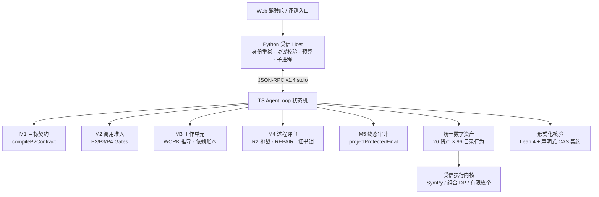

# Zygos

**ZY · 天轭**（原 Astra，旧名保留于技术入口与兼容标识）

**目标契约驱动 · 证据受控 · 有界调度 · 可逆修复的可核查数学推理运行时**

Zygos 把问题目标、工作任务、候选答案、评审依据和调用预算放进同一条执行链：Python 受信 Host 负责协议可信与执行隔离，TypeScript 状态机负责动态智能体循环，统一数学资产负责精确计算，形式化审查负责"什么可以交付"。

赛题：**XH-202627《基于 Intern-S1 的数学智能体设计与推理创新》**（挑战杯"揭榜挂帅" · 上海人工智能实验室）。

[架构](#架构) · [快速开始](#源码快速开始) · [数学资产](#统一数学资产) · [形式化审查](#形式化内部审查) · [实测与口径](#实测与诚实口径) · [开发验证](#开发与验证) · [文档索引](#文档索引)

---

## 三个核心创新

1. **双核隔离 + 双侧镜像的可信执行**：模型只产出数学内容，8 个身份字段由 Host 权威重绑为控制数据；Host 与 TS 对同一历史做逐条镜像的投影与选票（规范化答案键、COMPLETE/4096 过滤、首包回退），伪造身份、合成答案、跨任务污染一律 fail-closed。配套 R1–R4 崩溃恢复（防 PID 复用、归档优先提交、派发即计数、`dispatchState` 未发送贯通）。
2. **单一事实源的统一数学资产与结构路由**：20 方法卡 × 22 数学族 × 76 历史工具收敛为 **26 资产 × 96 目录行为**；`math-assets.json` 唯一事实源，TS/Python 双端代码确定性生成，SHA-256 冻结门禁。路由分三层：`semanticToolRoute` 措辞规则先定位（未命中诚实不路由）→ `semanticMethodRoute` 打分保留 ≤3 候选方法 → `semanticMathAssetRoute` 以 **8 维数学结构签名**（符号域、量词结构、算子等）兜底选资产——按结构泛化而非题面关键词。
3. **机器可判定审查 + 可逆修复闭环**：R2 挑战 → 确定性闭合（16 类缺陷固定顺序）→ **6 类声明式 CAS 契约 + Lean 4 可判定义务核验** → 多反例全覆盖 REPAIR → R4 → M5 终态裁决；机器反例优先，**形式化证书保护锁**禁止无凭证文本质疑覆写已核验答案。去相关独立 ballot（5 独立 + 2 审计 + 1 证书，lens 轮换、不暴露候选、逐分量多数、**绝不合成答案**；两审计一致可推翻票数并锚定审计结论）。

## 当前能力与边界

| 方向 | 当前实现 | 边界 / 未完成 |
| --- | --- | --- |
| 统一执行入口 | `user_agent.ReasoningAgent` 默认 `engine="ts"`；Python Host 管理注入 client、协议与子进程 | 官方目标环境的 Node/子进程验收以平台确认为准 |
| 动态数学工作流 | 目标契约 → 任务 DAG、G2 停滞让渡、版本化产物与失效传播、G7 断点续推 | — |
| 数学资产 | **26 资产 / 96 目录行为（82 项 E2E 门禁）**，空壳资产清零；统一动作 `action:"math_asset"`，Host 唯一入口 `use_math_asset`；旧 target 别名兼容 | v6 新增能力尚未做真实模型全量回归 |
| 形式化审查 | Lean 4 五类可判定义务 + 离线精确符号降级（明确标记）；6 类声明式 CAS 闭合契约；M4 证书保护锁 | 离线无 Lean 内核时走降级路径；`candidate_verified` 恒为 `false` |
| 交互展示 | React 19 + Starlette BFF 驾驶舱：7 标签审计、SSE 实时事件、确定性回放、23/23 CDP 交互验收 | — |
| 长跑可靠性 | 100 题 v8 实测 **93/100 交付候选**；单根预算只紧不松；未知 Token 显式记录 | 语义正确率仍是主要提升目标 |

## 架构



主求解链：

```
原始题 → 目标契约(义务/DAG) → R0 三重审阅 → WORK 长程推导(64KB 依赖投影)
  → 独立 ballot(5+2+1) → 确定性闭合 + 声明式契约 → R2 挑战 → REPAIR(全覆盖) → R4
  → M5 projectProtectedFinal → candidate（candidate_verified=false）
```

任何分支失败：保留既有候选（模式 A）或输出诚实失败与未关闭义务（模式 B）。

| 层 / 模块 | 代码位置 | 职责 |
| --- | --- | --- |
| 官方入口 | [user_agent.py](user_agent.py) | `ReasoningAgent.solve()` 唯一入口 |
| Python Host | [python/astra_bridge](python/astra_bridge) | 协议校验、身份重绑、投影镜像、预算、工具执行、崩溃恢复 |
| TS 组合根 | [apps/stdio-runtime/src/agent-loop.ts](apps/stdio-runtime/src/agent-loop.ts) | 任务调度、consensus、闭合、终态选择 |
| 结构路由与语义 | [apps/stdio-runtime/src/agent-semantics.ts](apps/stdio-runtime/src/agent-semantics.ts) | 8 维数学结构签名、工具/方法/资产路由 |
| 闭合与声明式契约 | [apps/stdio-runtime/src/agent-answer-closure.ts](apps/stdio-runtime/src/agent-answer-closure.ts) | 4 类确定性闭合 + 6 类 CAS 不变量契约 |
| M1–M5 包 | [packages/math-contract](packages/math-contract)、[math-gateway](packages/math-gateway)、[math-workunit](packages/math-workunit)、[math-review](packages/math-review)、[math-audit](packages/math-audit) | 目标契约 / 准入 / 工作单元 / 评审 / 审计 |
| Runtime Core | [packages/runtime-core](packages/runtime-core) | 根预算、事件、上下文投影、生命周期 |
| Lean 4 核验 | [python/astra_bridge/lean4_verifier.py](python/astra_bridge/lean4_verifier.py) | 5 类可判定义务、离线符号降级、诚实证据分级 |
| 通用算子 | [mathagent/core/generalized_math_operators.py](mathagent/core/generalized_math_operators.py) | 14 个新增通用算子实现 |
| 数学资产 | [mathagent/resources/math-assets.json](mathagent/resources/math-assets.json) | 唯一事实源（26 × 96） |
| Web | [apps/web-demo](apps/web-demo)、[python/astra_web](python/astra_web) | 驾驶舱与只读 BFF、SSE、回放 |

## 统一数学资产

- **单一事实源** `math-assets.json` → `scripts/build_math_assets.py` 确定性生成 TS/Python 双端视图；冻结哈希门禁保护 22 数学族、20 方法卡与 v1.2 schema。
- **统一动作** `{"action":"math_asset","assetId":...,"target":...,"input":{...}}`，Host 统一 `use_math_asset`，效应收据跨轮次复用。
- **证据四级分流**：`EXACT_FOR_INPUT`（仅对给定输入精确）/ `EXHAUSTIVE`（有界全集穷举）/ `SAMPLE`（抽样观察）/ `HEURISTIC`（提示性）——**抽样与启发式永不升级为全称证明**。
- **14 个新增通用算子（v6）**：置换字求值与规范轮换、Laurent 多项式矩阵不变量（一阶 Fitting 理想子式 GCD）、Berlekamp–Massey 递推、特征方程通解、压缩映射不动点、有限拓扑公理检验、单纯 Euler/同调、覆盖空间基本群交换化、MLE/Fisher 得分核验、抽样分布分位数、线性回归 ANOVA 恒等式、Lean4 义务核验、有界反例搜索、布尔 SAT/重言式判定。
- **验收**：82 项历史行为 E2E 100% 通过（含旧 target 别名兼容）；48/48 方法卡模板真实执行成功；24 项机器验收指标。
- **复用与迁移**：资产目录 + 运行时 bundle 可打包导出，其他 agent 经同一 `use_math_asset` 通道接入复用、**不改其主链**；新学科 = 新增资产 JSON + 消费契约，无需改动运行时主链。

## 形式化内部审查

1. **确定性闭合**：选项覆盖、次数守恒（精确 maximal-minor 观测）、密度归一、解集完备；候选保护后到达的精确观测可增量重开闭合。
2. **6 类声明式 CAS 契约**：代数等价、Laurent 单位因子规范、解空间基维度、置换规范轮换、测度归一、选项真值证书（`evaluateDeclarativeClosureContract`）。
3. **Lean 4 可判定义务**：`finite_decidable`、`integer_linear_omega`、`algebraic_ring_identity`、`linear_inequality`、`counterexample_eval`；离线环境降级为精确符号判定并标记 `SYMBOLIC_DECIDER_FALLBACK`，**无界采样绝不标记 PROVED**。
4. **证书保护锁**：`setFormalOrExactCertificate` / `isOverridePermitted`——已机器核验的答案不被无凭证的 LLM 文本质疑覆写。
5. **可逆修复**：反例全覆盖 REPAIR + 父候选保留 + R4 复核；修不好就不许劣化。

## 实测与诚实口径

| 口径 | 数值 | 说明 |
| --- | --- | --- |
| 100 题交付候选（v8，fcbd311） | **93/100** | 真实模型全量单轮 |
| 100 题语义正确（独立判分） | **73%** | 同模型 · 同题集 · 同预算 · 独立判分，非官方平台分 |
| 失败题 | 7 | 未解、超时、异常均计入分母 |
| 严格 ReferenceJudge | 25/100 | 格式敏感，仅对照，**不是数学准确率** |
| 十题分支交付（v8 容错链） | 10/10 | R0→WORK→5/2/1→R2→REPAIR→R4 全链路 |
| 82 资产行为 E2E | 82/82 | 离线门禁，不代表解题正确率 |

- `candidate_verified` 恒为 `false`；`strictAcceptance=NOT_PERFORMED`。
- 86/91/96/97 等定向修复/合并口径**禁止作为成绩引用**。
- 已验证的方法论结论：**加采样轮次不提分，补精确计算能力才提分**（§28 定向实验）。
- 四臂同预算对照设计：A/B（基线/官方 API）如实记 `NOT_RUN`；C（增强关）vs D（增强开）用于归因 R0 + 修复机制贡献。
- **v6（96 目录行为、Lean4、声明式契约）尚未完成真实模型全量回归**；已知一项 Host/TS closure 采纳规则双侧分歧正在修复（`fix/closure-source-trust`），修复前不宣称 v6 提分。其余未解决项：5-ballot 未同口径全量复跑、多路径独立性仅同模型 lens 去相关（非多模型）。

## 源码快速开始

### 环境要求

| 依赖 | 要求 |
| --- | --- |
| Python | `>=3.10`（SymPy、NumPy、SciPy、Requests，见 [requirements.txt](requirements.txt)） |
| Node.js | 开发锁定 `24.7.0`（运行 TS 引擎必需；使用预编译 bundle 时无需 npm/pnpm/tsc） |
| pnpm / TypeScript | 仅修改构建 TS 时需要：pnpm `11.7.0`、TS `6.0.3` |
| Lean 4（可选） | 存在 `lean` 时启用内核证明；缺失自动走诚实降级 |
| 公共 client | 真实求解由平台或调用方注入；离线检查用模拟 client |

### 获取并校验

```bash
git clone --branch feat/web-unified-math-integration https://github.com/3294682143-gif/astra-refactored.git
cd astra-refactored
python -m venv .venv && . .venv/bin/activate
python -m pip install -r requirements.txt
python scripts/build_release_manifest.py --verify release/BUILD_MANIFEST.json   # VERIFY_OK
```

### 官方接口

```python
from user_agent import ReasoningAgent
result = ReasoningAgent(client=client).solve(problem, metadata)  # 默认 engine="ts"
```

- `client.chat(messages, temperature=0.2, max_tokens=8192)` 为唯一模型通道；密钥只从环境读取，Host 不另建请求通道。
- 其他引擎：`engine="lite"`（实验轻量）、`engine="legacy"`（保留路径）；TS 失败不会静默切换引擎。
- 主要 profile（跑分对照用，非默认值）：`max_model_calls=256, max_work_units=64, max_effects=2, max_reviews=2, max_method_loads=2, max_repairs=2, max_consensus=8, max_r0=1, problem_seconds=1800`。库默认是保守预览 profile（R0/修复/方法卡关闭）。

### 结果语义

```json
{"engine":"ts","status":"candidate","final_response":"4","candidate_verified":false,"strictAcceptance":"NOT_PERFORMED"}
```

- `status`：`candidate` / `unsolved`；未解、超时、异常在评测口径中计入分母。
- `stopReason` / `code`：调度停止与固定失败码（`BUDGET`、`DEADLINE_EXCEEDED`、`FIELD_VALUE` 等）。
- `trace` / `metrics`：脱敏控制事件与真实用量；**不是数学证明**。
- `REVISED_CANDIDATE` 表示经修复门控替换，仍不等于已验证。
- M5 终态裁决：受保护候选在未过期、预算/时限充足、非 STRICT 拒绝时交付 `candidate`（`submissionEligibility=BEST_EFFORT`），并附**逐义务覆盖表**；否则 `WITHHELD`（unsolved）并给固定原因 `NO_CANDIDATE / STALE_CANDIDATE / DEADLINE_EXCEEDED / STRICT_NOT_VERIFIED`。多选须 `CERT1|OPTIONS` 全覆盖，多问按 `MULTIPART` 覆盖所有 leaf 分问。

## 运行控制与恢复

- **事件溯源与确定性重放**：单一有序、append-only、链式哈希的事件日志是"模型看到什么"的唯一权威；每次调用的上下文是日志前缀的确定性投影，可无模型逐条重放（byte-identical）校验。
- **产物版本与精确失效**：重做 version+1、旧字节保留；仅将受影响下游闭包（target＋传递后继）标 STALE，无关产物保持 ACTIVE——局部修订不牵动全局。
- **单根预算**：模型调用、工具效应、方法加载、评审修复共享上限与截止时间（前台 25% / 尾部保留 10% 配额）；新增任务不刷新配额，只能收紧。
- **未知终态责任**：缺完成信号或超时记 `OUTCOME_UNKNOWN`，停止等待 ≠ 远端停止，不重放未知请求；确定的超长输出按 TRUNCATED 容错而非误判未知。
- **G7 checkpoint/resume**：校验题目、契约、事件序列与已用预算，预算只紧不松。
- **Web 恢复（R1–R4）**：终态先落盘再提交、进程实例身份防 PID 复用、`dispatchState` 区分未发送/发送后未知、恢复绝不把系统故障冒充模型未解。
- **执行边界**：问题、方法卡和工具输出作为数据处理，不能扩大模型或工具权限；本机测试、安装可复现性与比赛平台许可分别记录，互不冒充。

## 开发与验证

```bash
python -m pip install -r requirements-dev.txt
pnpm install --offline --frozen-lockfile --ignore-scripts
node node_modules/typescript/bin/tsc -b
node --test packages/protocol/dist/tests/*.test.js apps/stdio-runtime/dist/tests/*.test.js
python -m pytest -q
```

**改 TS 后必须**：`tsc -b` → esbuild 重建 `release/stdio-runtime.bundle.mjs` → 重建 `BUILD_MANIFEST.json` → `--verify` → 全量测试。否则真实运行用的是旧 bundle。

| 验证范围 | 命令 / 文件 |
| --- | --- |
| 资产视图同步 | `python scripts/build_math_assets.py --check` |
| 冻结基线 | `python scripts/check_math_assets_frozen.py` |
| 迁移与验收 | `python scripts/check_math_assets_migration.py`、`scripts/report_math_assets_acceptance.py` |
| 82 行为 E2E | `python -m pytest tests/e2e/test_ts_math_assets_82_e2e.py` |
| v6 靶向回归 | `python -m pytest tests/e2e/test_v6_targeted_regression_e2e.py` |
| 声明式契约单测 | `apps/stdio-runtime/tests/agent-declarative-closure.test.ts` |
| 入口与恢复 | `tests/e2e/test_ts_entry*.py`、`test_ts_binding_parity.py`、`test_ts_transport_recovery.py` |
| 发布清单 | `python scripts/build_release_manifest.py --verify release/BUILD_MANIFEST.json` |

离线 E2E 用模拟模型响应 + 真实 Host/Node/受信工具，证明工程行为，**不提供真实模型准确率结论**。

## 文档索引

| 阅读目的 | 文档 |
| --- | --- |
| 交接与演进总账（最新实装） | [HANDOFF.md](HANDOFF.md) |
| 贡献约定 | [AGENTS.md](AGENTS.md) |
| 资产统一说明 | [MATH_ASSETS_UNIFIED.md](MATH_ASSETS_UNIFIED.md) |
| 当前门槛与发布阻断 | [GATEBOARD](docs/GATEBOARD.md)、[RELEASE_BLOCKERS](docs/RELEASE_BLOCKERS.md) |
| 主循环与 Host 接入 | [UNIFIED_TS_AGENT_LOOP](docs/UNIFIED_TS_AGENT_LOOP.md)、[TS_ENGINE_ENTRY](docs/TS_ENGINE_ENTRY.md) |
| 动态任务与产物版本 | [G2_DYNAMIC_ROUTES](docs/G2_DYNAMIC_ROUTES.md)、[G2_ARTIFACT_REDO](docs/G2_ARTIFACT_REDO.md) |
| 运行时机制 | [G4_RUNTIME_HARDENING](docs/G4_RUNTIME_HARDENING.md) |
| 对照评测配置 | [RUN_CONFIG_LOCK](docs/RUN_CONFIG_LOCK.md)、[MATH_AB_REPORT](docs/MATH_AB_REPORT.md) |
| 安装 | [INSTALL](INSTALL.md) |
| 品牌与命名迁移 | [NAMING](docs/NAMING.md)、[RENAME_MIGRATION](docs/RENAME_MIGRATION.md) |

## 品牌与贡献

正式品牌 **Zygos（ZY，天轭）**；当前为阶段 A（品牌统一与内部整合），仓库/包名/环境变量仍用 `astra-*` / `@astra/*` / `ASTRA_*`，阶段 B 集中迁移（见 [ADR-011](docs/adr/ADR-011-zygos-brand-and-two-phase-migration.md)）。

提交前阅读 [AGENTS.md](AGENTS.md)：保持官方接口、注入式模型访问、根预算、未知请求责任与执行隔离；仓库不接收凭据、个人安装配置、私有运行日志、标准答案或针对评测题制作的题卡。仓库当前未提供项目级 LICENSE 文件。
