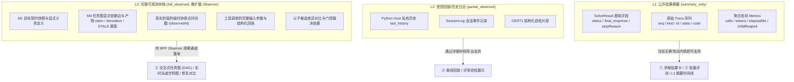

# 01 来源、基线与数据可获得性分级

> **交付性质**：G-01 阶段产物（信息架构与设计溯源）。
> **编制角色**：G (`gemini-3.8-flash-high`)
> **监督者**：H（人工负责人）
> **对应执行方案**：§12, §13, §14, §17

---

## 1. 代码基线与执行环境核验

| 检查项 | 核验结果 | 说明与约束 |
| :--- | :--- | :--- |
| **代码仓库** | `3294682143-gif/astra-refactored` | 本地工作区：`C:\Users\y\OneDrive\Desktop\挑战杯\复赛\astra-refactored` |
| **当前工作分支** | `前端设计` | 远端追踪 `origin/前端设计`，已对齐最新提交 |
| **本次锁定基线 commit** | `eb36a5acadc5de53d1c436b63faefca193b7d3f4` | 每次补丁基于此 commit 检出，不跨分支拼接事实 |
| **监督与架构模型 G** | `gemini-3.8-flash-high` | 负责信息架构、交互原型、设计交接与阶段验收 |
| **工程实现模型 D** | `deepseek-v4.1-flash` (华为云 MaaS) | 负责只读复核、各模块工程化、测试与打包 |
| **人工监督者 H** | 用户 | 拥有架构批准、契约冻结（F1）与最终验收裁决权 |

---

## 2. 数据可获得性三级模型 (Data Availability Levels)

根据对当前代码（`user_agent.py`、`agent_runtime.py`、`agent-host-flow.ts`）的只读核对，公开返回的 `SolveResult` 与内部状态存在明显分水岭。为防止前端展示虚构数据，制定三级可获得性模型：

### 分级定义表

| 等级 | 标识 | 数据来源 | 前端呈现能力与约束 | 缺数据时的产品降级 |
| :--- | :--- | :--- | :--- | :--- |
| **L1** | `summary_only` | 公开 `ReasoningAgent.solve()` 导出的标准 `SolveResult` JSON | 仅支持：求解工作台结果卡、基本指标、无真实时间的事件序号列表、批量导入看板。 | **绝对禁止**根据 `trace` 的 id 猜测任务依赖边；DAG 面板降级为“活动执行流水列表”，并明确提示「当前为 L1 摘要数据，未包含任务依赖图」。 |
| **L2** | `partial_observed` | 包含 `SessionLog` / `last_history` 的运行历史存档 | 支持：按事件序号逐步重放、CERT1 结构化自检表格、方法卡加载记录。 | 无真实毫秒时间戳时，甘特图禁用绝对毫秒轴，改为「逻辑步数序号轴」；无参数的工具仅显示操作名。 |
| **L3** | `full_observed` | BFF 通过独立 Demo Observer 捕获的完整事件流（含快照与依赖引用） | 支持完整体验：React Flow 增量 DAG、失效传播动画、父子候选 diff、毫秒时间线、角色协作编排视图。 | 完整呈现所有高级标签页；若个别事件丢包，单点标记 `MISSING_REF`，不导致整站白屏。 |

---

## 3. 不能仅靠当前公开结果获得的数据清单 (Data Gaps)

以下数据在当前官方 `solve()` 公开返回中**不存在**，前端在 G-01 阶段明确将其列为「需依赖 BFF 扩展或详细存档补充」的项，禁止在界面中用 Mock 假数据冒充真实运行：

1. **题目原文与局部假设**：`SolveResult` 仅返回 `final_response`，不回显输入的 `problem`；前端需由 BFF 存档层将输入与输出组合存储。
2. **任务图显式依赖（Edges）**：`trace` 中只有独立的请求或动作记录，没有“任务 B 依赖产物 A”的指针。
3. **产物内容与推导过程**：`trace` 仅含受控 id（如 `A1`），不含数学推导文本、claim 或 STALE 原因。
4. **真实物理耗时戳**：`trace` 中的 `seq` 是整数序号，不带 `timestamp` 或 `elapsedMs`；无法直接绘制真实时间甘特图。
5. **父子候选版本文本 Diff**：仅有最终候选答案字符串，中间被拒绝（`REVISE_REJECTED`）或淘汰的候选文本未在公开结果中保留。
6. **M1 契约细节与义务清单**：公开结果仅有 `unresolvedObligations` 字符串列表，没有义务的详细目标定义和类型。
7. **运行中进度与事件流**：当前 `solve()` 为同步阻塞调用，运行中无主动 push 事件机制。
