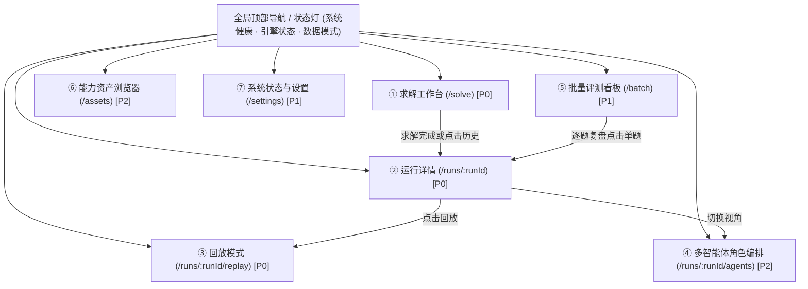

# 02 信息架构与状态矩阵规范 (G-01)

> **交付性质**：G-01 核心交付物（信息架构、状态矩阵、字段溯源与降级契约）。
> **编制角色**：G (`gemini-3.8-flash-high`)
> **复核输入**：已吸收并落实 D (`deepseek-v4.1-flash`) 在 `00-d00-feasibility-review.md` 中的 P0/P1 改写建议。
> **监督者**：H（人工负责人）
> **对应执行方案**：§0, §1, §3, §4, §13, §17, 附录 A

---

## 1. 核心定位与设计红线

前端**不是聊天机器人对话框**，而是面向 Intern-S1 数学智能体「目标契约 → 任务调度 → 产物版本 → 评审修复 → 审计交付」全生命周期的**可观测控制台**。

### 必须坚守的硬性红线（锁死规则）
1. **真实性原则**：`candidate_verified` 恒为 `false`，界面绝对不出现「已证明 / 正确 / 验证完成 / ✅」等误导性文案，所有产出均标为「候选答案 · 未经形式化验证」。
2. **工具是观察不是证明**：工具与方法卡调用结果一律标为「观察（Observation）」，禁用打勾徽章。
3. **严格区分三级数据深度（L1/L2/L3）**：
   - **L1（公开结果摘要）**：只有 `seq/kind/id/state/code`，仅能支持事件流水表与状态分组；**严禁根据 trace id 臆造 DAG 依赖边或虚构时间戳**。
   - **L2（受控历史会话）**：含 `SessionLog` / `last_history`，支持逻辑序号回放、CERT1 自检表格。
   - **L3（完整观察存档）**：仅在 Demo Observer 捕获到完整依赖、产物版本和时间戳时，才点亮高保真任务图与毫秒甘特图。
4. **生命周期不混淆**：明确区分「停止求解（断开会话）」与「强制取消（终止子进程 + 回收资源）」。
5. **参数合法性保护**：`max_method_loads` 在界面中作为「方法卡准入开关（开=1/关=0）」，禁止使用允许超过 1 的数值输入框。

---

## 2. 页面地图与三类角色旅程



### 角色用户旅程与首要诉求

| 角色 | 核心页面 | 典型操作旅程 | 首要回答的核心问题 |
| :--- | :--- | :--- | :--- |
| **评委 (Judges)** | `/solve` <br> `/runs/:runId` | 挑选公开测试题 → 点击开始求解 → 观察实时阶段推进与预算消耗 → 查看候选答案与审计依据 | 1. 智能体是怎么一步步思考的？<br>2. 它的答案依据是什么？凭什么替换了答案？<br>3. 资源开销和调用预算是多少？ |
| **演示者 (Presenters)** | `/runs/:runId/replay` <br> `/runs/:runId/agents` | 切换为全屏演示模式 → 载入预录制典型题（如包含 R2 挑战与修复的案例）→ 步进播放关键帧 → 展示角色协作泳道 | 1. 在现场无网/模型卡顿时能否 100% 稳定演示推理过程？<br>2. 关键决策点（如拒绝错误修复）能否被清晰突出？ |
| **开发复盘者 (Engineers)** | `/batch` <br> `/runs/:runId` <br> `/settings` | 导入百题运行日志与判分文件 → 筛选 `unsolved` 题目 → 下钻运行详情 → 查看事件码与未解义务 | 1. 这道题未解是因为数学推理失败、预算超限还是底层子进程崩溃？<br>2. 算法修改后多次运行的极差是否稳定？ |

---

## 3. 全局页面信息结构设计

### ① 求解工作台 `/solve` (优先级: P0)
- **输入区**：Markdown + LaTeX 双栏实时预览；预置公开示范题库（代数数论、几何分析等公开经典题，不包含评测赛题）；元数据编辑。
- **配置面板**：
  - 引擎选择：`ts`（默认生产推荐）/ `lite`（实验标记）/ `legacy`。
  - 预算档位：预设「演示均衡档（demo-balanced）」/「严格受限档」/「消融对照档」；`max_method_loads` 为单次准入开关。
- **执行控制栏**：
  - `[开始求解]`：发起任务，进入队列。
  - `[断开会话]`：向后端发送停止接收信号。
  - `[取消并清理]`：有界强制回收（未就绪时附 tooltip 提示）。
- **实时看板**：
  - M1-M5 线性阶段流高亮条。
  - 实时预算仪表（模型调用、效果、截止时间倒计时）。
  - 实时事件滚动窗（最新 50 条）。
- **结果卡**：
  - 固定警示条：「候选答案 · 未经形式化验证」。
  - 状态标签（`candidate` / `unsolved`）。
  - 最终答案（KaTeX 渲染 + 原文切换）。
  - 终止原因（`stopReason` 中文归类解释）。
  - 关键耗时与进程回收状态（`childReaped`）。

### ② 运行详情 `/runs/:runId` (优先级: P0)
顶部常驻「运行摘要 Bar」，下方采用 7 标签页架构：
1. **目标契约 (M1)**：目标类型（`VALUE / COUNT / PROOF ...`）、局部假设、义务清单认领状态（若为 L1 数据，展示未解义务标识，详细结构标为待补充）。
2. **任务与产物图 (M3)**：
   - **L3 模式**：基于 React Flow + elkjs 的任务与产物版本 DAG，展示 STALE 失效链路与父子修复关系。
   - **L1/L2 降级模式**：自动切换为「扁平事件流 + 同 ID 聚合折叠面板」，明确提示「当前为摘要数据，未包含拓扑依赖边」。
3. **事件时间线**：
   - **序列轴视图**：按 `seq` 排序，按 `kind` 分组，按 `state` 着色，绑定 `code` 字典解释。
   - **毫秒甘特图**：仅在具备真实 `observedAt` 记录时启用，无时间戳时不绘制虚假时间轴。
4. **工具与方法卡**：
   - 工具调用回执列表（打「观察」标签，折叠 JSON 参数与结果）。
   - 方法卡加载清单（卡片 SHA-256、加载时机）。
5. **评审与修复 (M4/M5)**：
   - 评审轮次记录（R0/R2/R4）。
   - CERT1 结构化自检表格（标明为模型自检，非数学认证）。
   - 修复对比卡（父候选 vs 子候选，文本 Diff 与门控结果）。
6. **预算与指标**：全量 metrics 展示（调用数、效果数、工作单元数、token 覆盖率分析）。
7. **原始数据与审计**：只读 CodeMirror 查看原始 JSON，Schema 校验状态徽章，一键导出归档。

### ③ 回放模式 `/runs/:runId/replay` (优先级: P0)
- **数据源载入**：支持离线加载本地存档或上传历史 `SolveResult` JSON。
- **深度级别指示**：顶部显著展示当前回放级别——【L1 摘要回放】或【L3 完整回放】。
- **控制器**：播放 / 暂停、单步前进 / 后退、0.5x ~ 4x 倍速调节、进度条拖动。
- **关键帧书签**：一键跳转关键时刻（契约确定、产出候选、提出挑战、修复裁决、最终收口）。
- **演示辅助**：可选旁白字幕条，支持全屏大字号投影演示模式。

### ④ 多智能体角色编排 `/runs/:runId/agents` (优先级: P2)
- 将单循环中的阶段性动作映射到虚拟角色（Contractor, Solver, Critic, Auditor），展示共享账本机制。
- 明确标注说明：「此视图展示逻辑角色分工，非独立多模型实例协同」。

### ⑤ 批量评测看板 `/batch` (优先级: P1)
- 批次管理：导入外部测试批次 JSONL / 判分结果 CSV。
- 元信息权威标注：必须标注「评测协议 + 运行时间 + 判分器版本」，无出处数字不作结论。
- 逐题表格：支持按子领域、状态、stopReason 过滤，虚拟滚动支持 1000+ 题。
- 多批次稳定性对比：支持 2-3 个批次比对极差，验证盲跑稳定性。

### ⑥ 能力资产浏览器 `/assets` (优先级: P2)
- 方法卡目录（20 张 general_v11 卡片详情与决策表）。
- 数学族目录（22 个数学族领域与工具绑定关系）。
- 工具注册表（73 项工具及其准入级别说明）。
- 对齐矩阵看板（直观呈现方法卡与工具接入缺口）。

### ⑦ 系统状态与设置 `/settings` (优先级: P1)
- 后端与运行时健康检查（版本、Node 环境、bundle 校验）。
- 模型端点状态：仅展示「已配置 / 未配置」与可用状态，**禁止在前端输入或回显 API 密钥**。
- 前端显示偏好（浅色/深色主题、LaTeX 排版引擎开关、演示模式默认值）。

---

## 4. 全局字段与真实来源映射矩阵

| 界面字段 | 真实底层来源 | 产生阶段 | 字段分类 | 缺失时的降级外观 / 提示文案 |
| :--- | :--- | :--- | :--- | :--- |
| `status` | `summary.status` | 终态 | 🟢 可直接复用 | 必有字段；显示为「候选答案生成」或「未解」 |
| `final_response` | `summary.finalResponse` | 终态 | 🟢 可直接复用 | `unsolved` 时显示为空，并提示「未形成可交付候选答案」 |
| `candidate_verified` | 恒为 `False` | 终态 | 🟢 核心红线 | 强制展示灰色徽章「未经形式化验证」 |
| `stopReason` | `summary.stopReason` | 终态 | 🟢 可直接复用 | 必有字段；映射为附录 A 规范的中文解释 |
| `reason` | `summary.reason` | 终态 | 🟢 可直接复用 | 文本展示，缺失时展示「未提供详细原因说明」 |
| `sessionId` | `host.session_id` | 初始化 | 🟢 可直接复用 | 单号展示，可一键复制 |
| `childReaped` | `reaped` (布尔) | 终态 | 🟢 可直接复用 | 显示为「子进程已回收」或「子进程状态未确认」 |
| `seq` (事件序号) | `trace[].seq` | 运行期 | 🟢 可直接复用 | 驱动事件流水表排序与回放游标步进 |
| `kind` (事件类型) | `trace[].kind` | 运行期 | 🟢 可直接复用 | 映射为对应类型图标与徽章（MODEL / EFFECT / CONTROL） |
| `id` (动作标识) | `trace[].id` | 运行期 | 🔵 纯行键 | 作为唯一行 Key 或折叠分组依据，**不可当作 DAG 边** |
| `state` (状态) | `trace[].state` | 运行期 | 🟢 可直接复用 | 映射为状态点（COMPLETE / ACTIVE / STALE / FAILED） |
| `code` (状态码) | `trace[].code` | 运行期 | 🔵 映射适配 | 结合前端代码字典展示中文，并提供可解释性弹窗 |
| `reported_tokens` | `metrics.reported_tokens` | 终态 | 🟢 可直接复用 | 若为 `None`，显示「未知（远端未报告 Token）」而非 `0` |
| **任务依赖关系 (Edges)** | `SessionLog` (内部) | 运行期 | 🔴 外部缺失 | L1 下直接隐藏 DAG 连线，降级为活动流卡片 |
| **产物推导与文本** | `SessionLog` (内部) | 运行期 | 🔴 外部缺失 | 抽屉内提示「详细推导文本仅在完整存档模式可用」 |
| **真实事件时间戳** | `observedAt` (待采集) | 运行期 | 🔴 外部缺失 | 禁用毫秒时间轴，切换为「按执行步数（Step）展示」 |
| **题目输入原文** | BFF 持久化层 | 提交期 | 🔵 新增适配 | 导入历史外部 JSON 若无输入，提示「题目原文未归档」 |

---

## 5. 状态机与异常场景覆盖台账

### 5.1 核心状态判定逻辑
```ts
// 状态解释唯一优先级：先 status，再 stopReason，最后 reason/code
if (result.status === "candidate") {
  // 必须明确是候选答案，绝不显示为已证明
  badge = "候选答案 · 未经形式化验证";
  if (result.stopReason === "REVISE_REJECTED") {
    annotation = "原候选答案经评审挑战后触发修复，但修复方案未通过门控，依规保留交付原候选答案。";
  }
} else {
  // unsolved 状态必须进行归因分类
  badge = "未解 (Unsolved)";
  category = classifyStopReason(result.stopReason); // 数学未解 | 预算时限 | 系统故障
}
```

### 5.2 附录 A：stopReason 前端权威中文归类字典

| stopReason 原始码 | 状态归属 | 前端中文主标题 | 归属大类 | 详细解释与指引 |
| :--- | :--- | :--- | :--- | :--- |
| `REVIEWS_COMPLETE` | candidate | 评审结束，交付候选 | 正常交付 | 求解与各轮评审均完成，已交付合规候选答案。 |
| `NO_CANDIDATE` | unsolved | 未能形成候选答案 | 数学未解 | 推理分支未能收敛出符合条件的候选解。 |
| `REVISE_REJECTED` | candidate / unsolved | 修复未通过门控审查 | 数学未解 | 生成的修复产物被门控拒绝。若保留有原候选则交付原候选，否则未解。 |
| `BUDGET_EXHAUSTED` | unsolved | 求解预算已耗尽 | 预算 / 时限 | 达到模型调用上限或工作单元上限，求解有界收口。 |
| `DEADLINE_EXCEEDED` | unsolved | 运行超过规定时限 | 预算 / 时限 | 达到最大求解时间限制，进程安全终止。 |
| `SPAWN_FAILED` | unsolved | 运行时启动失败 | 系统故障 | Node 子进程启动失败，检查本地运行环境配置。 |
| `TIMEOUT` | unsolved | 子进程通信超时 | 系统故障 | Host 与运行时交互超时，子进程未在预定时限响应。 |
| `CHILD_FAILED` | unsolved | 运行时进程异常退出 | 系统故障 | Node 子进程非零退出或 stderr 输出异常错误。 |
| `FIELD_VALUE` | unsolved | 结果格式校验失败 | 系统故障 | 运行时返回的数据结构未满足协议校验要求。 |
| `TRANSPORT_STOP` | unsolved | 模型通信传输中断 | 系统故障 | 远端模型 API 出现网络断开或网关不可达。 |

---

## 6. G-01 交付结论与后续动作

1. **信息架构与状态规范确立**：完成了 7 大页面模块、三类角色旅程、以及全量字段来源映射表。
2. **全面对齐 D-00 可行性约束**：
   - 彻底将 L1/L2/L3 模式的呈现边界在架构中物理切开，杜绝一切无据推断；
   - 预算面板将 `max_method_loads` 改为单选准入开关；
   - 回放面板正式确立「L1 摘要回放」与「L3 完整回放」双轨制。
3. **下一步执行**：
   - **G-02**：制定《03 视觉方向与设计系统规范》（包含三种视觉方向对比、Design Tokens、响应式适配规范）。
