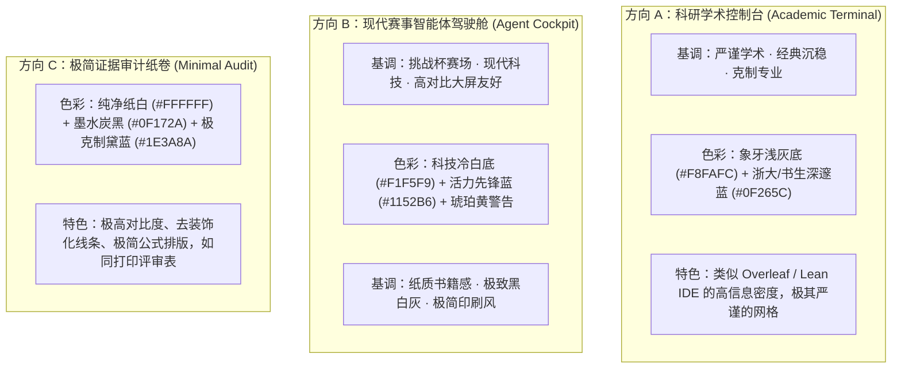

# 03 视觉方向与设计系统规范 (G-02)

> **交付性质**：G-02 核心交付物（三种视觉方向探索、Design Tokens 草案、响应式适配与交互规范）。
> **编制角色**：G (`gemini-3.8-flash-high`)
> **监督者**：H（人工负责人 / 需由 H 裁决选定其中一种视觉方向）
> **对应执行方案**：§3.1, §4②, §8, §15, §20 (G-02)

---

## 1. 视觉设计原则与品牌标识

1. **工程品牌标识**：使用「**Zygos · 天轭**」，副标「*可审计数学推理智能体运行时*」。
2. **官方素材引用**：本地在 `C:\Users\y\OneDrive\Desktop\挑战杯\复赛\官方素材包` 中提供了官方高分辨率透明底 Logo 及 IP 形象，在展示时优先直接链接引用官方 SVG/PNG，杜绝未经授权的重绘。
3. **科学严肃性与投影清晰度**：
   - 答辩现场通常采用投影仪（1920×1080 或 1280×720），对比度易损失，因此正文字符与底色对比度必须满足 **WCAG AA 级（≥ 4.5:1）**。
   - 严禁单靠颜色区分状态：所有状态指示灯均需配备文本标签或几何图标（实心圆点、警告三角、禁用圆圈）。
4. **数学公式与排版优先**：KaTeX 本地离线字体排版，行内公式与正文基线平齐，独立公式块保持横向居中并支持溢出滚动。

---

## 2. 三种可比较的视觉方向方案

为方便人工负责人（H）对比裁决，三种方案均基于**同一套标准化合成数据场景**（包含：题目输入、M1-M5 阶段流、预算仪表、L1 摘要流水与 L3 节点抽屉）进行评估：



### 三种方向特性深度横评表

| 维度 | 方向 A：科研学术控制台 (Academic) | 方向 B：赛事驾驶舱 (Cockpit，推荐) | 方向 C：极简证据审计 (Minimal) |
| :--- | :--- | :--- | :--- |
| **视觉基调** | 严谨克制、学术工具感、重逻辑 | 现代科技、比赛竞技感、高可视性 | 极简书卷、报纸印刷感、去装饰化 |
| **背景底色** | `#F8FAFC`（浅冷灰） | `#F0F4F8`（轻浅冰蓝灰） | `#FFFFFF`（纯净纸白） |
| **主品牌色** | `#0F265C`（天轭深蓝） | `#1152B6`（书生先锋蓝） | `#1E293B`（板岩墨黑） + `#1E3A8A` |
| **卡片与边框** | 1px 实线 `#E2E8F0`，直角/微圆角 (4px) | 1px 细线 `#CBD5E1`，圆角 (8px)，浅投影 | 1px 极简线条 `#000000`，无投影 (0px) |
| **字号与密度** | 正文 13px / 紧凑型，行高 1.4 | 正文 14px / 适度舒适，行高 1.5 | 正文 14px / 呼吸感强，行高 1.6 |
| **阶段进度条** | 线性步骤条，带罗马数字编号 (I..V) | 胶囊形高亮步骤条，带动态脉冲呼吸光效 | 极简实心黑块与空心框，纯文字标记 |
| **投影仪适应度** | 良好（文字清晰） | **极佳（高对比、远视距易辨识）** | 极佳（黑白反差极大） |
| **推荐适用场景** | 专家评审逐行推导查验、小范围闭门评审 | **挑战杯全国总决赛大屏答辩、现场互动 Demo** | 论文截图、成果归档、PDF 导出 |

---

## 3. Design Tokens 设计变量草案 (以推荐方案 B 为准)

```css
:root {
  /* 品牌与基准色 */
  --color-primary: #1152b6;         /* Zygos 先锋主蓝 */
  --color-primary-deep: #0f265c;    /* 天轭深蓝（顶栏与高权重大标题） */
  --color-primary-light: #eef4ff;   /* 选中态与浅底激活色 */
  --color-primary-hover: #0d4294;

  /* 背景与表面层级 */
  --bg-app: #f1f5f9;                /* 全局背景色（Slate 100） */
  --bg-surface: #ffffff;            /* 卡片面板主底色 */
  --bg-surface-subtle: #f8fafc;     /* 次级面板底色（Slate 50） */
  --border-subtle: #e2e8f0;         /* 分割线与普通边框 */
  --border-active: #94a3b8;         /* 焦点与聚焦边框 */

  /* 文字层级（满足 WCAG AA 4.5:1） */
  --text-primary: #0f172a;          /* 主要文字（Slate 900, 对比度 14:1） */
  --text-secondary: #475569;        /* 说明与二级文字（Slate 600, 对比度 5.8:1） */
  --text-muted: #64748b;            /* 辅助与标签文字（Slate 500, 对比度 4.6:1） */
  --text-disabled: #94a3b8;         /* 禁用与不可点击 */

  /* 状态与证据语义色（严格遵守项目规范） */
  --status-candidate-bg: #eff6ff;   /* 候选答案底色（蓝） */
  --status-candidate-text: #1d4ed8;
  --status-candidate-border: #bfdbfe;

  --status-observation-bg: #f0fdf4; /* 工具观察底色（绿） */
  --status-observation-text: #15803d;
  --status-observation-border: #bbf7d0;

  --status-warning-bg: #fffbeb;     /* 挑战与预算临界底色（黄） */
  --status-warning-text: #b45309;
  --status-warning-border: #fde68a;

  --status-error-bg: #fef2f2;       /* 故障与拒绝底色（红） */
  --status-error-text: #b91c1c;
  --status-error-border: #fecaca;

  --status-stale-bg: #f1f5f9;       /* 失效产物 STALE 底色（灰） */
  --status-stale-text: #94a3b8;
  --status-stale-border: #cbd5e1;

  /* 几何与阴影 */
  --radius-sm: 4px;
  --radius-md: 8px;
  --radius-lg: 12px;
  --shadow-sm: 0 1px 2px 0 rgb(0 0 0 / 0.05);
  --shadow-md: 0 4px 6px -1px rgb(0 0 0 / 0.08), 0 2px 4px -2px rgb(0 0 0 / 0.05);

  /* 动效 */
  --duration-fast: 150ms;
  --duration-normal: 250ms;
  --ease-standard: cubic-bezier(0.4, 0, 0.2, 1);
}
```

---

## 4. 关键视口与响应式断点适配规范

针对评委投影与不同设备，制定严格的视口规则：

| 视口规格 | 典型设备 | 布局与适配策略 | 绝对红线 |
| :--- | :--- | :--- | :--- |
| **1920 × 1080** | 决赛答辩现场投影 / 主力 PC | 全量三栏并列：左侧题目输入与配置，中央阶段与任务图，右侧事件流水与预算仪表；全屏无纵向滚动直接尽收眼底。 | 不截断关键候选卡；字号支持「演示模式」一键放大 1.25 倍。 |
| **1280 × 720** | 会议室小投影仪 / 笔记本屏 | 双栏折叠：左侧输入/配置可折叠收起；中央任务图与事件流纵向分块排布；右侧预算以顶部仪表条收纳。 | 保持操作按钮常驻可见，禁止出现横向死锁滚动条。 |
| **390 × 844** | 移动端应急查阅 | 单栏流式布局：底部 Tab 导航切换页面；**DAG 任务图降级为列表流展示**（手机端不强塞完整画布）。 | 移动端禁止拖拽排版 DAG，只展示结构化事件与候选卡。 |

---

## 5. 状态视觉与异常态设计规范

### 5.1 候选答案卡 (Candidate Card)
- 顶部常驻高警示灰蓝条：`🛡️ 候选答案（未经形式化验证） | 协议: TS_PREVIEW | 状态: candidate`
- 居中呈现 KaTeX 高精度排版结果，右上方提供 `[切换 LaTeX 源码]` 开关与 `[复制]` 按钮。
- 若 `stopReason === 'REVISE_REJECTED'`，在卡片下方附黄色警示块：`⚠️ 曾触发修复但未通过门控，依规保留交付原候选答案`。

### 5.2 产物状态 (ACTIVE vs STALE)
- **ACTIVE 产物**：实线主蓝框（`#1152B6`），背景浅蓝（`#EEF4FF`），清晰显示版本号（如 `v2`）与认领的义务标号。
- **STALE 产物**：灰色虚线框（`#94A3B8`），文字灰色带中划线，右上角打「已失效 (STALE)」印章，悬停提示引发失效的 upstream 变更。

### 5.3 预算仪表 (Budget Gauge)
- 三项关键指标横向排布：
  1. `模型调用`：进度条展示（如 `6 / 24` 次），消耗超 80% 变琥珀黄，达 100% 变砖红。
  2. `效果配额`：离散圆点展示（如 `● ○ (1/2)`）。
  3. `剩余时限`：动态倒计时（如 `08:45`），进入最后 60 秒闪烁提示。

---

## 6. G-02 决策建议与下一步动作

- **推荐选用方案**：**方向 B（赛事智能体驾驶舱）**，兼顾挑战杯现场答辩的远距离冲击力与学术工程的严谨可读性。
- **请人工负责人（H）确认**：是否同意以**方向 B**作为后续高保真原型（G-03）与前端组件工程化的基准设计系统。
