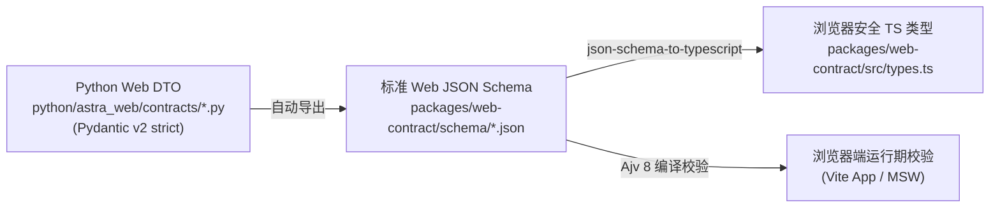

# 04 Web 数据契约与 DTO 规范 (G-04)

> **交付性质**：G-04 阶段产物（数据契约、DTO 模型与 JSON Schema 导出规范）。
> **编制角色**：G (`gemini-3.8-flash-high`)
> **实施角色**：D (`deepseek-v4.1-flash`, 待 D-01 落地)
> **代码基线**：`eb36a5acadc5de53d1c436b63faefca193b7d3f4`

---

## 1. 契约架构与单一权威源 (Single Source of Truth)

为了防止前端 TS 类型与后端 Python DTO 出现字段漂移，建立严格的单向代码生成管线：



### 核心约束
1. **绝对禁止前端直接引用 RPC Manifest**：`agent-host-v13.schema.json` 仅作为后端宿主 JSON-RPC 传输依据；前端使用的 Schema 必须是由 Pydantic 导出的独立 `SolveResultDto`、`RunEventDto` 等纯载荷（Payload）Schema。
2. **浏览器环境零 Node 依赖**：`packages/web-contract` 只导出纯类型定义与不可变常量字典，严禁静态导入 `node:crypto`、`node:fs` 或 `node:child_process`。
3. **大数与高精数学安全**：大整数、分数与 LaTeX 表达式一律保持 `string` 传输，禁止通过 JavaScript `Number` 解析造成精度截断。

---

## 2. 核心 DTO 模型定义

### 2.1 求解结果载荷 (`SolveResultDto`)
```typescript
export interface SolveResultDto {
  engine: "ts" | "lite" | "legacy";
  status: "candidate" | "unsolved";
  final_response: string;               // 候选答案文本，unsolved 时为空字符串
  candidate_verified: false;            // 恒为 false，核心红线
  strictAcceptance: "NOT_PERFORMED" | "PASSED" | "FAILED";
  mode: "TS_PREVIEW";
  targetEnvironment: "TARGET_UNVERIFIED";
  stopReason: string;                   // 如 REVIEWS_COMPLETE, NO_CANDIDATE, BUDGET_EXHAUSTED
  reason: string;                       // 详细说明
  unresolvedObligations: string[];      // 未解决的义务清单
  carrier: string;
  sessionId: string;
  trace: TraceRowDto[];
  metrics: MetricsDto;
  finishReason: string | null;
  childReaped: boolean;
  elapsedMs: number;
  code?: string;
}

export interface TraceRowDto {
  seq: number;
  kind: "MODEL" | "EFFECT" | "CONTROL";
  id: string;                           // 仅作为行键/聚合键，禁止臆造拓扑依赖边
  state: "ACTIVE" | "COMPLETE" | "STALE" | "FAILED";
  code: string;                         // 状态码
}

export interface MetricsDto {
  client_method_calls: number;
  logical_model_calls: number | null;
  effect_calls: number;
  review_calls: number;
  catalog_calls: number;
  method_loads: number;
  asset_calls: number;
  work_units: number | null;
  frames: number;
  remote_outcome_unknown: boolean;
  known_http_attempts: number | null;
  reported_tokens: number | null;       // null 表示未上报，禁止写成 0
  unknown_usage_requests: number;
}
```

### 2.2 事件流信封 (`RunEventEnvelope`)
```typescript
export type RunEventKind =
  | "QUEUED"
  | "RUN_STARTED"
  | "STAGE_CHANGE"
  | "TRACE"
  | "BUDGET"
  | "RESULT"
  | "RUN_ERROR"
  | "CANCEL_REQUESTED"
  | "RUN_TERMINATED";

export interface RunEventEnvelope<T = unknown> {
  runId: string;
  seq: number;                          // 全局单调递增
  kind: RunEventKind;
  at: number;                           // 客户端接收/观察到的毫秒时间戳
  sourceKind: "demo_fixture" | "official_result" | "observed_archive";
  detailLevel: "summary_only" | "partial_observed" | "full_observed";
  payload: T;
}
```

### 2.3 任务请求参数 (`RunRequestDto`)
```typescript
export interface RunRequestDto {
  problem: string;
  metadata?: Record<string, unknown>;
  engine?: "ts" | "lite" | "legacy";    // 默认 "ts"
  budget?: {
    max_model_calls?: number;           // 默认 24，范围 0..256
    max_work_units?: number;            // 默认 8，范围 1..64
    max_effects?: number;               // 默认 2，范围 0..2
    max_reviews?: number;               // 默认 1，范围 0..3
    max_method_loads?: 0 | 1;           // 严格单选开关：0 或 1
    max_repairs?: number;               // 默认 1，范围 0..3
    max_consensus?: number;             // 默认 2，范围 0..8
    max_r0?: 0 | 1;                     // 0 或 1
    problem_seconds?: number;           // 默认 600 秒
    policy?: "BEST_EFFORT" | "STRICT";
  };
}
```

---

## 3. 字段可获得性与降级映射表

| 字段 | 公开结果 | L2 历史日志 | L3 完整存档 | 降级策略（缺失时） |
| :--- | :---: | :---: | :---: | :--- |
| `status` / `final_response` | ✅ | ✅ | ✅ | 核心字段，必须呈现 |
| `trace[].seq / kind / state` | ✅ | ✅ | ✅ | 驱动事件流水表与序号轴 |
| `trace[].id` | ✅ | ✅ | ✅ | 仅作为列表 Key，**禁止绘制有向边** |
| 任务图依赖 (Edges) | ❌ | ❌ | ✅ | L1/L2 自动隐藏 DAG，切换为事件流水列表 |
| 产物推导详情 (Derivation) | ❌ | ⚠️ 部分 | ✅ | 抽屉展示「详细推导仅在完整存档模式可用」 |
| 事件物理时间戳 (`observedAt`) | ❌ | ❌ | ✅ | 禁用毫秒甘特图，启用逻辑步数序号轴 |
| 题目输入原文 | ❌ | ✅ | ✅ | 外部导入若无输入，提示「输入题目未归档」 |
