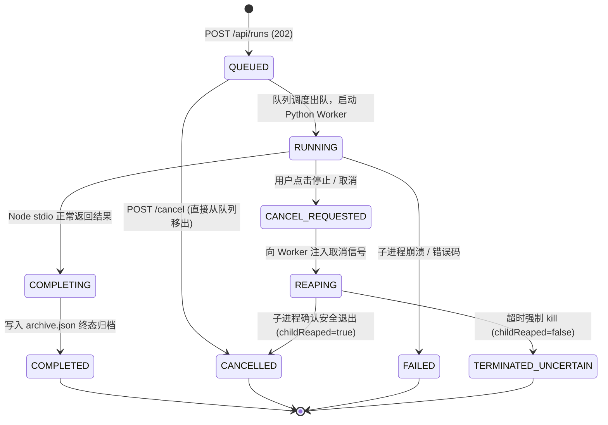

# 05 API 接口与事件流传输规范 (G-04)

> **交付性质**：G-04 阶段产物（BFF REST 接口、SSE 事件协议、会话生命周期与取消机制）。  
> **编制角色**：G (`gemini-3.8-flash-high`)  
> **实施角色**：D (`deepseek-v4.1-flash`, 待 D-03/D-06 落地)  
> **代码基线**：`eb36a5acadc5de53d1c436b63faefca193b7d3f4`

---

## 1. BFF REST API 规范

BFF 采用 **FastAPI** 框架，默认监听 `127.0.0.1:8000`，只服务于本地 Web Demo 与评测回放。

### 1.1 接口清单

| 方法 | 路径 | 状态码 | 请求体 / 参数 | 响应体 | 语义说明 |
| :--- | :--- | :---: | :--- | :--- | :--- |
| `GET` | `/api/health` | 200 | 无 | `HealthResponse` | 检查 BFF 服务状态、Node 版本与 manifest，**绝对不调用模型接口**。 |
| `GET` | `/api/capabilities` | 200 | 无 | `CapabilitiesResponse` | 返回当前服务端实际启用的引擎列表、最大并发数、取消能力支持状态。 |
| `POST` | `/api/runs` | 202 | `RunRequestDto` | `{ runId, status: "queued" }` | 提交求解任务进入执行队列；幂等设计（防网络重试重复派发）。 |
| `GET` | `/api/runs` | 200 | `page, pageSize, status` | `{ items: RunSummaryDto[], total }` | 查询运行历史列表（按提交时间倒序）。 |
| `GET` | `/api/runs/{runId}` | 200 / 404 | 无 | `RunDetailDto` | 获取指定运行详情。运行中 `result=null`，结束返回完整 `SolveResultDto`。 |
| `GET` | `/api/runs/{runId}/events` | 200 | `Last-Event-ID` header | `text/event-stream` (SSE) | 实时推送事件流。支持断线按 seq 续传；运行结束后发送终态事件并关闭。 |
| `POST` | `/api/runs/{runId}/cancel` | 202 | 无 | `{ runId, cancelStatus: "requested" }` | 申请停止/取消任务。排队任务直接移出；运行中执行有界子进程回收。 |
| `GET` | `/api/runs/{runId}/archive` | 200 / 404 | 无 | `RunArchiveDto` (JSON) | 下载包含元数据、完整事件与最终结果的离线归档包。 |
| `POST` | `/api/replays` | 201 | 上传 JSON / 存档文件 | `{ replayId, detailLevel }` | 导入离线结果或历史 SessionLog，返回可回放的 ID。 |
| `GET` | `/api/assets/{type}` | 200 | `type ∈ {methods, families, tools}` | 对应资产 JSON 列表 | 只读读取本地资源文件，供「能力资产浏览器」展示。 |

---

## 2. Server-Sent Events (SSE) 协议规范

- **内容类型**：`Content-Type: text/event-stream; charset=utf-8`
- **重连机制**：客户端携带 `Last-Event-ID: <seq>` 请求头，服务端从 `seq + 1` 开始续传历史事件，避免丢包与事件重复。
- **消息结构**：
  ```http
  id: 12
  event: TRACE
  data: {"runId":"run-8f3a","seq":12,"kind":"TRACE","at":1792780000120,"payload":{"seq":1,"kind":"MODEL","id":"M1_CONTRACT","state":"COMPLETE","code":"CONTRACT_COMPILED"}}

  id: 13
  event: BUDGET
  data: {"runId":"run-8f3a","seq":13,"kind":"BUDGET","at":1792780000150,"payload":{"modelCalls":1,"maxModelCalls":24,"remainingMs":598850}}

  id: 14
  event: RUN_TERMINATED
  data: {"runId":"run-8f3a","seq":14,"kind":"RUN_TERMINATED","at":1792780000900,"payload":{"status":"completed","childReaped":true}}
  ```
- **连接关闭时机**：客户端收到 `RUN_TERMINATED` 或 `RUN_ERROR` 终态事件后，必须主动执行 `eventSource.close()`，防止浏览器误判断线反复轮询重试。

---

## 3. 作业生命周期与安全取消状态机



### 关键语义红线
1. **停止（Stop / Disconnect）**：关闭 SSE 订阅与网络监听，后台 Worker 依然在既定预算与时限内安全收口。
2. **强制取消（Cancel）**：
   - 当后端 `capabilities.supportsCancellation === true` 时，触发 SIGTERM → 阶梯等待 → SIGKILL；
   - 若取消时进程已被强杀但远端模型请求尚未完成，系统标记 `remoteRequestState = "UNKNOWN"`，严格记录请求账本，不隐瞒未知状态。
